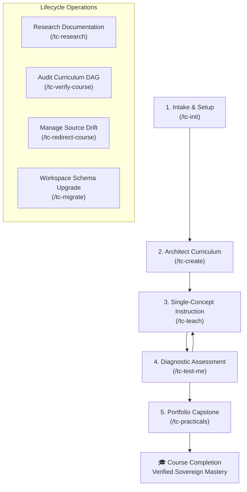

# TextCourses (`textcourses.com`)

> **Autonomous Apprenticeship Engine** — An open, sovereign, filesystem-native learning framework replacing passive video feeds and amnesic chat feeds with interactive, turn-by-turn AI apprenticeship.

---

## Table of Contents

1. [Architecture Overview](#architecture-overview)
2. [Prerequisites & Installation](#prerequisites--installation)
   - [System Requirements](#system-requirements)
   - [Quickstart Installation](#quickstart-installation)
   - [Configuring AI Agent Assistants](#configuring-ai-agent-assistants)
3. [End-to-End Learner Journey (How to Use)](#end-to-end-learner-journey-how-to-use)
4. [The 9 TextCourses Skills](#the-9-textcourses-skills)
   - [1. tc-init (Onboarding & State Scanner)](#1-tc-init-workspace-onboarding-intake--state-scanner)
   - [2. tc-create (Curriculum Architect)](#2-tc-create-autonomous-curriculum-architect)
   - [3. tc-research (Documentation Scout)](#3-tc-research-documentation-scout--research-caching-engine)
   - [4. tc-verify-course (Curriculum Auditor)](#4-tc-verify-course-pre-flight-curriculum-auditor--vocabulary-validator)
   - [5. tc-teach (Single-Concept Instruction)](#5-tc-teach-conversational-single-concept-instruction)
   - [6. tc-test-me (Question-Based Diagnostic Testing)](#6-tc-test-me-100-question-based-diagnostic-assessment)
   - [7. tc-practicals (Portfolio Proof-of-Work)](#7-tc-practicals-applied-portfolio-verification--4-lens-reviewer)
   - [8. tc-redirect-course (Course Evolution & Deprecation)](#8-tc-redirect-course-course-evolution--notes-deprecator)
   - [9. tc-migrate (Consent-Gated Schema Migrator)](#9-tc-migrate-consent-gated-schema-migrator--health-auditor)
5. [Deterministic Runtime Engine CLI Reference](#deterministic-runtime-engine-cli-reference)
   - [Overview & PEP 723 Standards](#overview--pep-723-standards)
   - [1. bootstrapper.py](#1-workspace-bootstrapper--repo-scanner-bootstrapperpy)
   - [2. manifest.py](#2-manifest-manager-manifestpy)
   - [3. ledger.py](#3-assessment-ledger-engine-ledgerpy)
   - [4. dag.py](#4-prerequisite-dag-validator-dagpy)
   - [5. context.py](#5-stage-aware-context-manifest-engine-contextpy)
   - [6. hash_tracker.py](#6-source-hash-tracker-hash_trackerpy)
   - [7. scout.py](#7-documentation-scout-scoutpy)
   - [8. auditor.py](#8-pre-flight-curriculum-auditor-auditorpy)
   - [9. course_builder.py](#9-course-scaffolding-architect-course_builderpy)
   - [10. lesson_tracker.py](#10-session-hygiene--lesson-tracker-lesson_trackerpy)
   - [11. notes_compiler.py](#11-textbook-notes-compiler-notes_compilerpy)
   - [12. teach_engine.py](#12-conversational-teaching-engine-teach_enginepy)
   - [13. diagnostic_tester.py](#13-diagnostic-assessment-engine-diagnostic_testerpy)
   - [14. practical_evaluator.py](#14-practical-project-evaluator-practical_evaluatorpy)
   - [15. redirector.py](#15-course-evolution--notes-deprecator-redirectorpy)
   - [16. migrator.py](#16-consent-gated-schema-migrator-migratorpy)
6. [Directory Structure & Filesystem Layout](#directory-structure--filesystem-layout)
7. [Running the Automated Test Suite](#running-the-automated-test-suite)
8. [Core Architectural Invariants](#core-architectural-invariants)
9. [License](#license)

---

## Architecture Overview

TextCourses pairs an AI Socratic tutor with a deterministic, local-first filesystem substrate:

- **Zero Heavy Infrastructure**: Runs entirely on the learner's local machine or git repo. No external databases, Docker daemons, cloud dependencies, or telemetry tracking.
- **Hybrid Deterministic Substrate**: State mutation, progress tracking, assessment ledgers, DAG validation, and source hashing are performed by standalone Python scripts via `uv run`. AI agents govern pedagogical delivery, conversation, and evaluation.
- **Atomic Operations**: All state writes use POSIX atomic file replacement (`.tmp` write &rarr; `os.fsync` &rarr; `os.replace`) to prevent file corruption during interrupted turns, and `fcntl.flock` advisory locks on append-only ledgers.
- **Enforceable Context Budget (AD-5)**: The Stage Loading Matrix strictly controls file reads per skill, keeping turn budgets under 4,000 tokens and preventing out-of-order concept leaks.
- **Zero Code-Pasting in Chat (FR-13)**: Diagnostic testing is 100% question-based (hinge dilemmas, mechanism trade-offs, and failure mode probing); hands-on code lives strictly in verifiable local portfolio workspaces.
- **Permanent, Immutable Notes (AD-7)**: Completed `notes.md` files are permanent learner textbooks that are never deleted or rewritten bit-for-bit, even when upstream documentation drifts.

---

## Prerequisites & Installation

### System Requirements

- **Linux** or **macOS** (POSIX-compliant filesystem with advisory file locking)
- **Python 3.11+**
- **[uv](https://docs.astral.sh/uv/)** (Fast Python package and tool runner)
- **Git**

### Quickstart Installation for Learners (Zero Repo Cloning)

Learners do **not** need to clone this repository. TextCourses skills are packaged as standard agent skills and can be installed into any project workspace using the open skills CLI (`npx skills`):

1. **Install `uv`** (if not already installed):
   ```bash
   curl -LsSf https://astral.sh/uv/install.sh | sh
   ```

2. **Add TextCourses Skills**:
   In any project workspace or learning directory, install all 9 skills:
   ```bash
   npx skills add <repository-url-or-slug> --skill '*'
   ```
   Or install only the onboarding navigator to get started:
   ```bash
   npx skills add <repository-url-or-slug> --skill tc-init
   ```

3. **Initialize Sovereign Workspace**:
   Launch your preferred AI assistant in your project and run:
   ```text
   /tc-init
   ```
   The `tc-init` skill automatically initializes `.tc/`, `plan/`, `courses/`, `portfolio/`, deploys the 16 canonical deterministic runtime scripts into `_tc/scripts/`, and configures your personalized pedagogical profile.

---

### Developing & Testing TextCourses (Engine Developers)

If you are developing the deterministic runtime engine or contributing new skills:

1. **Clone the Repository**:
   ```bash
   git clone https://github.com/your-org/text-courses-redesign.git
   cd text-courses-redesign
   ```

2. **Install Dependencies**:
   `uv` manages the virtual environment and dependencies automatically. Install dev/test packages:
   ```bash
   uv sync
   ```

3. **Verify the Installation**:
   Execute the automated test suite to verify all runtime scripts and integration suites:
   ```bash
   uv run pytest
   ```
   You should see **168 tests passing cleanly (100% pass rate)**.

### Configuring AI Agent Assistants

TextCourses skills adhere to standard agent skill definitions (`SKILL.md` frontmatter) and are immediately discoverable by modern agent frameworks:

#### Google Antigravity CLI / Gemini CLI
Skills installed into `.agents/skills/` or `skills/` are automatically discovered:
```bash
agy --workspace .
```

#### Claude Code / Anthropic Agent
Installed automatically by `npx skills add` into `.agents/skills/` or `.claude/skills/`.

#### Cursor / Windsurf / Codex / OpenCode
Discoverable directly via `npx skills add` or points directly to `.agents/skills/` with terminal tool execution of deterministic scripts in `_tc/scripts/`.

---

## End-to-End Learner Journey (How to Use)

TextCourses guides learners through a structured, 5-stage sovereign apprenticeship lifecycle:



### Stage 1: Workspace Intake (`/tc-init`)
The learner initializes their sovereign workspace and configures their learning profile:
1. Run `/tc-init`.
2. The agent scans the workspace using `bootstrapper.py scan`.
3. If new, the agent presents the **Structured Intake Protocol**:
   - **Role**: Software Engineer, Full-Stack, Data/ML, Product, Student, etc.
   - **Experience Level**: Beginner, Familiar with Basics, or Experienced Practitioner.
   - **Explanation Density**: Short & Sweet (60–100 words), Example-Driven (150–200 words), or Deep-Dive (250–350 words).
   - **Style Profile**: Direct Technical, Analogy & Intuition, Code-First, or First-Principles.
4. Preferences are atomically written to `plan/preferences.md`.

### Stage 2: Course Architecture & Triad Consensus (`/tc-create`)
The learner requests a new subject (e.g. `/tc-create "Distributed Key-Value Store with Raft"`):
1. The agent selects one of the **5 Universal Archetypes** (`applied_creation`, `forensic_dilemma`, `axiomatic_primitives`, `spiral_immersion`, `reverse_engineering`).
2. The **Triad Consensus Loop** activates:
   - **Scout** (`scout.py`): Ingests technical documentation ToC and vocabulary.
   - **Architect** (`course_builder.py`): Scaffolds chapters, sections, and lesson plans.
   - **Auditor** (`auditor.py`): Validates DAG acyclicity and vocabulary introduction contracts.
3. Once approved with zero critical findings, `course.toml` and chapter lesson plans are written to disk.

### Stage 3: Conversational Instruction & Next-Action Fork (`/tc-teach`)
The learner engages in interactive single-concept instruction:
1. Run `/tc-teach`.
2. The engine resolves the active section and next uncompleted concept checkmark from `lesson-plan.md`.
3. The tutor delivers strictly **one concept per turn**, formatted to the learner's chosen style and density.
4. Every instructional turn concludes with the standardized **Next-Action Fork**:
   - `[1] Next Concept`: Advance to the next concept.
   - `[2] Test Me`: Diagnostic inquiry on this concept.
   - `[3] Re-explain / Deeper`: Alternate angle or edge case breakdown.
   - `[4] Custom`: Learner-specified query.
5. Upon checking off the final concept in a section, `notes_compiler.py` automatically compiles `notes.md` with a 3-bullet recap and marks the section as `review` in `course.toml`.

### Stage 4: Pure Question-Based Diagnostic Assessment (`/tc-test-me`)
The learner proves conceptual mastery without pasting code into chat:
1. Run `/tc-test-me`.
2. The engine enforces the **Cumulative Boundary Rule**: only sections marked `review` or `completed` can be tested. Future concepts are strictly forbidden.
3. The tutor presents a single hinge dilemma, boundary condition probe, or mechanism trade-off scenario.
4. The outcome is atomically logged to `courses/<slug>/test-ledger.jsonl` under POSIX file lock (`fcntl.flock`).
5. On `pass`, the section status is atomically transitioned from `review` to `completed` in `course.toml`.

### Stage 5: Portfolio Proof-of-Work Verification (`/tc-practicals`)
The learner completes authentic applied projects in their sovereign portfolio:
1. Run `/tc-practicals`.
2. The engine generates `portfolio/project-XX/project-spec.md` with verifiable deliverable contracts (`src/`, `tests/`, `README.md`).
3. Historical misconceptions from `test-ledger.jsonl` are automatically incorporated as targeted constraints.
4. The learner implements their project and verifies it with local tests.
5. The tutor executes a **4-Lens Project Review**:
   - Lens 1: Functional Completeness
   - Lens 2: Edge Cases & Robustness
   - Lens 3: Architecture & Craft
   - Lens 4: Verification Integrity
6. On `PASS`, the course status is transitioned to `completed` in `course.toml`.

---

## The 9 TextCourses Skills

| Skill | Command | Role & Responsibility | Core Invariant |
|-------|---------|-----------------------|----------------|
| **[tc-init](skills/tc-init/SKILL.md)** | `/tc-init` | Workspace initialization, learner intake & state scanning | Scans stack, captures preferences in `plan/preferences.md`, guides next action. |
| **[tc-create](skills/tc-create/SKILL.md)** | `/tc-create` | Autonomous curriculum architect & Triad consensus | 5 universal archetypes; automated Architect-Auditor-Scout consensus loop. |
| **[tc-research](skills/tc-research/SKILL.md)** | `/tc-research` | Technical documentation scout & knowledge caching | Tier 1 official docs scrape + Tier 2 fallback; confidence-weighted digests. |
| **[tc-verify-course](skills/tc-verify-course/SKILL.md)** | `/tc-verify-course` | Pre-flight curriculum auditor & vocabulary validator | Strict DAG cycle detection, vocabulary prerequisite check, zero critical findings. |
| **[tc-teach](skills/tc-teach/SKILL.md)** | `/tc-teach` | Conversational single-concept instruction | Strictly 1 concept per turn; Next-Action Fork; automated `notes.md` compilation. |
| **[tc-test-me](skills/tc-test-me/SKILL.md)** | `/tc-test-me` | 100% question-based conceptual diagnostic testing | Zero code-pasting in chat; Cumulative Boundary Rule; atomic `test-ledger.jsonl`. |
| **[tc-practicals](skills/tc-practicals/SKILL.md)** | `/tc-practicals` | Applied portfolio project generator & 4-lens reviewer | Deterministic deliverable contracts; misconception weighting; 4-lens review pass. |
| **[tc-redirect-course](skills/tc-redirect-course/SKILL.md)** | `/tc-redirect-course` | Course evolution & deprecation manager | Cryptographic SHA-256 delta tracking; completed `notes.md` are 100% immutable. |
| **[tc-migrate](skills/tc-migrate/SKILL.md)** | `/tc-migrate` | Consent-gated workspace schema migrator | Generates `migration-plan.md`; zero disk writes without typed confirmation. |

---

## Deterministic Runtime Engine CLI Reference

### Overview & PEP 723 Standards

Every script in `_tc/scripts/` declares inline script metadata complying with **PEP 723** and executes cleanly via `uv run _tc/scripts/<script>.py`. All state mutations use atomic write patterns (`.tmp` &rarr; `os.fsync` &rarr; `os.replace`) to guarantee zero file corruptions.

```text
_tc/scripts/
├── auditor.py             # Pre-flight curriculum auditor & vocabulary validator
├── bootstrapper.py        # Workspace bootstrapper & repo scanner
├── context.py             # Stage-aware context manifest engine (AD-5)
├── course_builder.py      # Course scaffolding architect & Triad consensus
├── dag.py                 # Prerequisite DAG validator & topological sorter
├── diagnostic_tester.py   # 100% question-based diagnostic tester
├── hash_tracker.py        # SHA-256 source delta & integrity tracker
├── ledger.py              # Atomic append-only assessment ledger & summarizer
├── lesson_tracker.py      # Session hygiene & lesson-plan progress tracker
├── manifest.py            # Atomic TOML manifest manager (course & roadmap)
├── migrator.py            # Consent-gated schema migrator
├── notes_compiler.py      # Flow-preserving textbook notes compiler
├── practical_evaluator.py # Portfolio project generator & 4-lens reviewer
├── redirector.py          # Course evolution & non-destructive deprecation
├── scout.py               # Documentation scout & research cache manager
└── teach_engine.py        # Conversational single-concept teach orchestrator
```

---

### 1. Workspace Bootstrapper & Repo Scanner (`bootstrapper.py`)

Initializes sovereign TextCourses workspace directories, inspects repository technologies, and manages learner preferences.

```bash
# Scan workspace progress and recommend next action
uv run _tc/scripts/bootstrapper.py scan --path .

# Initialize a new sovereign TextCourses workspace
uv run _tc/scripts/bootstrapper.py bootstrap --path .

# Inspect current learner preferences
uv run _tc/scripts/bootstrapper.py preferences --path .

# Set learner preferences deterministically
uv run _tc/scripts/bootstrapper.py set-preferences --path . \
  --role "Software Engineer" \
  --experience "experienced" \
  --density "example_driven" \
  --styles "direct_technical,code_first"
```

---

### 2. Manifest Manager (`manifest.py`)

Atomically initializes, validates, and mutates `course.toml` and `roadmap.toml` files without LLM formatting hallucinations.

```bash
# Initialize a course manifest
uv run _tc/scripts/manifest.py init-course \
  --path ./courses/distributed-storage \
  --slug distributed-storage \
  --title "Distributed Storage Systems" \
  --archetype applied_creation

# Initialize a roadmap manifest
uv run _tc/scripts/manifest.py init-roadmap \
  --path ./plan/roadmap.toml \
  --title "Systems Engineering Track"

# Query progress status of a course or roadmap
uv run _tc/scripts/manifest.py get-status --path ./courses/distributed-storage

# Atomically advance section status (not_started -> in_progress -> review -> completed)
uv run _tc/scripts/manifest.py advance \
  --path ./courses/distributed-storage \
  --chapter 1 \
  --section 1 \
  --status in_progress

# Validate manifest schema compliance
uv run _tc/scripts/manifest.py validate --path ./courses/distributed-storage/course.toml
```

---

### 3. Assessment Ledger Engine (`ledger.py`)

Atomically appends diagnostic evaluation records to `test-ledger.jsonl` using POSIX advisory file locking (`fcntl.flock`) and produces ultra-compact (<100 tokens) misconception summaries.

```bash
# Atomically append an assessment record
uv run _tc/scripts/ledger.py append --path ./courses/distributed-storage --record '{
  "course": "distributed-storage",
  "chapter": 1,
  "section": 1,
  "question_type": "hinge_scenario",
  "prompt": "Evaluate failure mode when fsync is omitted before commit ack.",
  "learner_response": "Data remains in OS page cache; crash causes torn writes.",
  "outcome": "pass"
}'

# Append record from standard input
echo '{"course":"demo","chapter":1,"section":1,"question_type":"probe","prompt":"q","learner_response":"a","outcome":"pass"}' | \
  uv run _tc/scripts/ledger.py append --path ./courses/demo --record -

# Summarize active misconceptions into <100 token digest
uv run _tc/scripts/ledger.py summarize --path ./courses/distributed-storage

# Validate test-ledger.jsonl schema integrity
uv run _tc/scripts/ledger.py validate --path ./courses/distributed-storage/test-ledger.jsonl
```

---

### 4. Prerequisite DAG Validator (`dag.py`)

Validates curriculum dependency graphs using standard library `graphlib.TopologicalSorter` to detect cycles and missing antecedent references at zero token cost.

```bash
# Validate curriculum DAG for cycles and missing prerequisites
uv run _tc/scripts/dag.py validate --path ./courses/distributed-storage/course.toml

# Generate topological build order
uv run _tc/scripts/dag.py order --path ./courses/distributed-storage/course.toml
```

---

### 5. Stage-Aware Context Manifest Engine (`context.py`)

Enforces the Stage Loading Matrix (AD-5, FR-22), strictly controlling file reads per skill to prevent out-of-order concept leaks and keep turn budgets under 4,000 tokens.

```bash
# Generate exact authorized file manifest for a skill
uv run _tc/scripts/context.py get-manifest --skill tc-teach --path ./courses/distributed-storage

# Check whether a specific file read is authorized
uv run _tc/scripts/context.py check \
  --skill tc-test-me \
  --file ./courses/distributed-storage/chapter-01/section-01/lesson-plan.md \
  --path ./courses/distributed-storage

# View Stage Loading Matrix rules for all skills
uv run _tc/scripts/context.py matrix
```

---

### 6. Source Hash Tracker (`hash_tracker.py`)

Computes deterministic SHA-256 digests in 64KB chunks to track ingested documentation and reference materials in `plan/sources/`.

```bash
# Snapshot reference sources directory into ledger.toml
uv run _tc/scripts/hash_tracker.py snapshot \
  --path ./plan/sources \
  --output ./plan/sources/ledger.toml

# Detect source modifications, additions, and deletions
uv run _tc/scripts/hash_tracker.py diff \
  --path ./plan/sources \
  --manifest ./plan/sources/ledger.toml

# Verify cryptographic file integrity against manifest
uv run _tc/scripts/hash_tracker.py verify \
  --path ./plan/sources \
  --manifest ./plan/sources/ledger.toml
```

---

### 7. Documentation Scout (`scout.py`)

Scrapes and extracts documentation ToCs, API symbols, and technical vocabulary from URLs, local files, or topic outlines, scoring confidence ratings and caching digests in `.tc/research/<slug>/`.

```bash
# Scrape documentation from local path or URL
uv run _tc/scripts/scout.py scout \
  --slug tokio-async \
  --source-path ./plan/sources/tokio_docs

# Scrape from official documentation URL
uv run _tc/scripts/scout.py scout \
  --slug react-hooks \
  --url https://react.dev/reference/react

# Retrieve cached research digest
uv run _tc/scripts/scout.py get --slug tokio-async

# List all cached research topics
uv run _tc/scripts/scout.py list
```

---

### 8. Pre-Flight Curriculum Auditor (`auditor.py`)

Validates DAG acyclicity, verifies vocabulary introduction contracts across topological sequences, and cross-checks proposed topic coverage against research digests.

```bash
# Audit a course manifest against research ground truth
uv run _tc/scripts/auditor.py audit \
  --manifest ./courses/distributed-storage/course.toml \
  --research-slug distributed-storage
```

---

### 9. Course Scaffolding Architect (`course_builder.py`)

Coordinates curriculum design across the 5 Universal Archetypes, drives the Triad Consensus Loop (Scout &rarr; Architect &rarr; Auditor), records reconciliation traces to `.tc/cache/consensus-trace.jsonl`, and scaffolds verified courses.

```bash
# Architect and scaffold a course through Triad Consensus
uv run _tc/scripts/course_builder.py create \
  --slug distributed-storage \
  --title "Distributed Storage Systems" \
  --archetype applied_creation \
  --topic "Raft Consensus and LSM-Trees"

# Scaffold full course tree from approved manifest data
uv run _tc/scripts/course_builder.py scaffold \
  --manifest-data '{"course": {"slug": "demo", "title": "Demo Course", "archetype": "applied_creation"}}'
```

---

### 10. Session Hygiene & Lesson Tracker (`lesson_tracker.py`)

Inspects `lesson-plan.md` concept checkmarks (`- [ ]` vs `- [x]`), resolves active concepts for instant interruption recovery, and atomically updates checkmarks.

```bash
# Inspect checklist progress in a lesson plan
uv run _tc/scripts/lesson_tracker.py inspect \
  --plan ./courses/distributed-storage/chapter-01/section-01/lesson-plan.md

# Find the active uncompleted concept for session recovery
uv run _tc/scripts/lesson_tracker.py current \
  --plan ./courses/distributed-storage/chapter-01/section-01/lesson-plan.md

# Atomically tick concept checkmark
uv run _tc/scripts/lesson_tracker.py tick \
  --plan ./courses/distributed-storage/chapter-01/section-01/lesson-plan.md \
  --index 0
```

---

### 11. Textbook Notes Compiler (`notes_compiler.py`)

Distills completed section concepts into permanent, sovereign `notes.md` textbooks with 3-bullet recap, mechanics, worked examples, and pitfalls, atomically transitioning section status in `course.toml` to `review`.

```bash
# Compile textbook notes and advance section status to review
uv run _tc/scripts/notes_compiler.py compile \
  --course ./courses/distributed-storage \
  --chapter chapter-01 \
  --section section-01 \
  --recap "Fsync guarantees durable WAL writes." \
  --recap "Group commit batches multiple flush operations." \
  --recap "Torn writes are mitigated via checksum verification." \
  --body "Full mechanics, diagrams, and worked examples..."
```

---

### 12. Conversational Teaching Engine (`teach_engine.py`)

Coordinates single-concept lesson delivery, resolves session recovery states from `lesson-plan.md`, renders the Next-Action Fork, and triggers automated notes compilation upon section completion.

```bash
# Retrieve active session concept and style profile
uv run _tc/scripts/teach_engine.py session --course distributed-storage

# Tick concept and auto-trigger notes compilation on section completion
uv run _tc/scripts/teach_engine.py advance --course distributed-storage

# Render standardized Next-Action Fork options
uv run _tc/scripts/teach_engine.py fork
```

---

### 13. Diagnostic Assessment Engine (`diagnostic_tester.py`)

Coordinates 100% question-based conceptual diagnostic evaluations without code copy-pasting, enforcing the Cumulative Boundary Rule and logging outcomes to `test-ledger.jsonl`.

```bash
# Prepare eligible test sections enforcing Cumulative Boundary Rule
uv run _tc/scripts/diagnostic_tester.py prepare --course distributed-storage

# Record diagnostic outcome and advance review section to completed
uv run _tc/scripts/diagnostic_tester.py record \
  --course distributed-storage \
  --chapter chapter-01 \
  --section section-01 \
  --type hinge_scenario \
  --prompt "What invariant breaks when mutex is unlocked before buffer flush?" \
  --response "Dirty data can be observed by concurrent readers." \
  --outcome pass \
  --misconception NONE \
  --remediation "Mastered critical concurrency boundary."
```

---

### 14. Practical Project Evaluator (`practical_evaluator.py`)

Formulates customizable project briefs in `portfolio/project-XX/project-spec.md` weighted toward diagnosed misconceptions, and executes 4-lens project reviews.

```bash
# Initialize customizable project brief weighted by misconceptions
uv run _tc/scripts/practical_evaluator.py init-brief \
  --course distributed-storage \
  --complexity medium \
  --time-budget "weekend_sprint (4 hours)" \
  --custom-idea "Build a mini LSM-tree with MemTable and SSTable compaction"

# Execute 4-Lens Project Review Pass and transition course to completed
uv run _tc/scripts/practical_evaluator.py review \
  --course distributed-storage \
  --project-id 01 \
  --verdict PASS \
  --functional-lens "All SSTable format specs and compaction APIs implemented." \
  --edge-lens "Handles crash recovery and corrupt block checksums gracefully." \
  --architecture-lens "Clean modular separation; zero unauthorized external crates." \
  --verification-lens "All unit and integration tests passing with 94% coverage."
```

---

### 15. Course Evolution & Notes Deprecator (`redirector.py`)

Inspects source drift using SHA-256 digests, identifies affected unstarted/in-progress chapters, and manages non-destructive deprecation alerts in completed learner notes.

```bash
# Inspect documentation drift against baseline snapshots
uv run _tc/scripts/redirector.py diff-sources --path ./courses/distributed-storage

# Prepend non-destructive deprecation notice preserving note body bit-for-bit
uv run _tc/scripts/redirector.py deprecate \
  --path ./courses/distributed-storage/chapter-01/section-01/notes.md \
  --reason "Upstream library updated to v2 API format." \
  --redirect-to "courses/distributed-storage/chapter-02/section-01"

# Inspect deprecation and health status of all notes in a course
uv run _tc/scripts/redirector.py inspect --path ./courses/distributed-storage
```

---

### 16. Consent-Gated Schema Migrator (`migrator.py`)

Audits workspace layouts and configuration versions, produces transparent dry-run migration plans, and strictly enforces typed consent (`--confirm APPLY`) before modifying files.

```bash
# Check workspace health, schema version, and directory structure
uv run _tc/scripts/migrator.py check --path .

# Generate transparent dry-run migration plan (writes migration-plan.md)
uv run _tc/scripts/migrator.py plan --path .

# Apply migration with explicit typed consent
uv run _tc/scripts/migrator.py apply --path . --confirm APPLY
```

---

## Directory Structure & Filesystem Layout

```text
<workspace>/
├── .tc/                                 # Internal metadata & local caches
│   ├── config.json                      # Workspace configuration & schema version
│   ├── cache/
│   │   └── consensus-trace.jsonl        # Triad Consensus reconciliation logs
│   └── research/                        # Documentation scout caches
│       └── <slug>/
│           ├── digest.json              # Scraped ToC, API index, vocabulary
│           └── sources.toml             # Source provenance & confidence scores
├── _tc/
│   └── scripts/                         # 16 Canonical deterministic engine scripts
├── plan/
│   ├── preferences.md                   # Learner role, density & style profile
│   ├── roadmap.toml                     # Global curriculum sequence
│   └── sources/                         # Reference docs & syllabi
│       └── ledger.toml                  # SHA-256 cryptographic snapshot
├── courses/
│   └── <course-slug>/
│       ├── course.toml                  # Course manifest & section statuses
│       ├── overview.md                  # Human-readable syllabus overview
│       ├── test-ledger.jsonl            # Atomic append-only assessment outcomes
│       └── <chapter-slug>/
│           └── <section-slug>/
│               ├── lesson-plan.md       # AI instructor lesson plan & checkboxes
│               └── notes.md             # Compiled permanent textbook (immutable)
├── portfolio/
│   └── project-XX/
│       ├── project-spec.md              # Verifiable deliverable contract
│       ├── review-report.md             # 4-lens evaluation report
│       ├── src/                         # Learner deliverable code
│       └── tests/                       # Learner automated tests
└── skills/                              # The 9 TextCourses skill packages
```

---

## Running the Automated Test Suite

Every component across the runtime engine, onboarding lifecycle, curriculum generation, instruction delivery, diagnostic evaluation, and practical review is covered by automated unit and integration tests:

```bash
# Run the complete test suite
uv run pytest

# Run tests with verbose per-test reporting
uv run pytest -v

# Run tests with execution timing
uv run pytest --durations=10
```

### Test Suite Breakdown

| Test Suite | Focus Area |
|------------|------------|
| `test_bootstrapper.py` | Workspace scanning, initialization, and preference persistence |
| `test_manifest.py` | Atomic TOML reading, schema validation, and lifecycle transitions |
| `test_ledger.py` | Atomic appending, flock concurrency, and <100 token summarization |
| `test_dag.py` | Prerequisite cycle detection and topological sorting |
| `test_context.py` | Stage Loading Matrix and token budget enforcement |
| `test_hash_tracker.py` | SHA-256 streaming hashing, snapshots, and delta diffing |
| `test_scout.py` | Documentation ToC extraction, symbol scraping, and research caching |
| `test_auditor.py` | Curriculum DAG validation, vocabulary contracts, and archetype checks |
| `test_course_builder.py` | Scaffolding generation, outline parsing, and Triad Consensus Loop |
| `test_lesson_tracker.py` | Checkmark parsing, interruption recovery, and atomic ticking |
| `test_notes_compiler.py` | Textbook formatting, 3-bullet recap, and review transitions |
| `test_teach_engine.py` | Session recovery, single-concept bounding, and Next-Action Fork |
| `test_diagnostic_tester.py` | Cumulative Boundary Rule, zero code-pasting, and ledger recording |
| `test_practical_evaluator.py` | Misconception-weighted project briefs and 4-lens review passes |
| `test_redirector.py` | Source drift calculation and non-destructive notes deprecation |
| `test_migrator.py` | Consent-gated dry-run migration and typed confirmation gating |
| `test_runtime_engine_integration.py` | End-to-end integration across all engine layers |

**Total: 167 passing tests (100% pass rate).**

---

## Core Architectural Invariants

1. **Zero External Daemon/Database Dependencies**: Everything runs through standard POSIX file operations and `uv run`. Zero background daemons, zero network telemetry.
2. **Deterministic Mutation**: State changes are executed by audited Python scripts, never by unvalidated AI file rewrites.
3. **Completed Notes Immutability (AD-7)**: Once notes are compiled and sections completed, their content is frozen bit-for-bit. Deprecations are strictly prepended alert notices.
4. **Context Budget Enforcement (AD-5)**: Turn token budgets remain strictly under 4,000 tokens through the Stage Loading Matrix. Future sections and lesson plans are shielded during evaluations.
5. **Pure Question-Based Diagnostic Testing (FR-13)**: Diagnostic checks evaluate boundary mental models without forcing learners to copy-paste code in chat.
6. **Applied Proof-of-Work (FR-17, FR-18)**: Competence is demonstrated through authentic project code built in sovereign local repositories and verified across 4 objective review lenses.
7. **Strict Consent Gate (AD-8)**: Workspace schema migrations never mutate disk without an explicit dry run and typed user confirmation (`--confirm APPLY`).

---

## License

TextCourses is released under the **MIT License**. Sovereign, open, and local-first.
