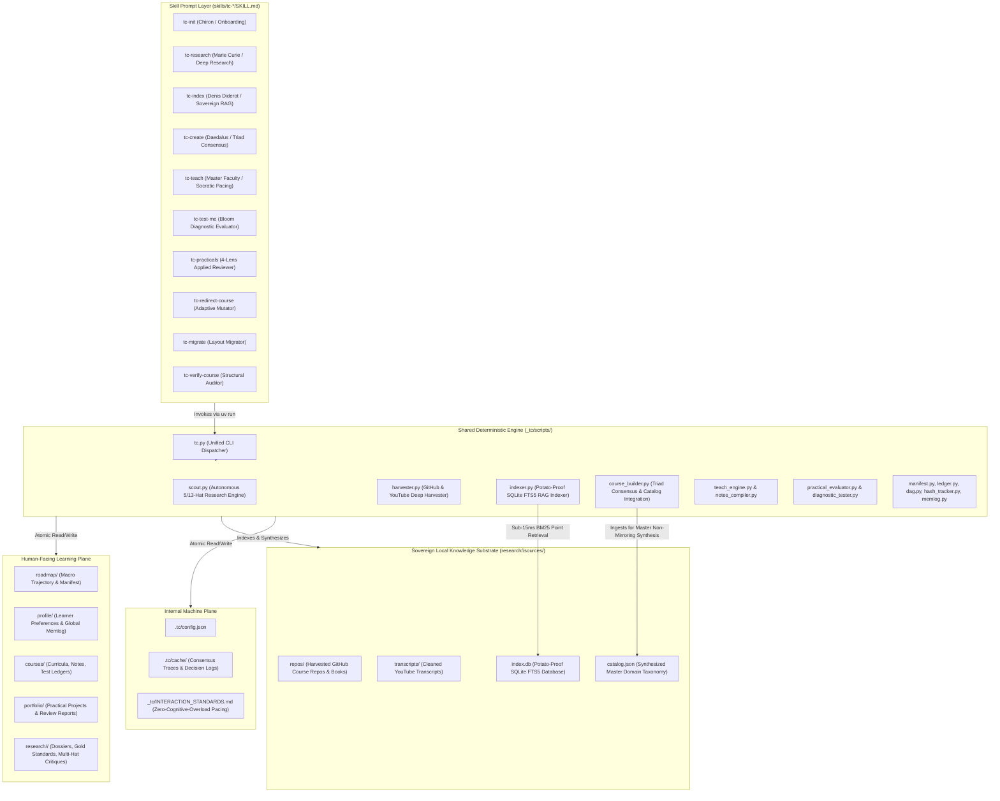
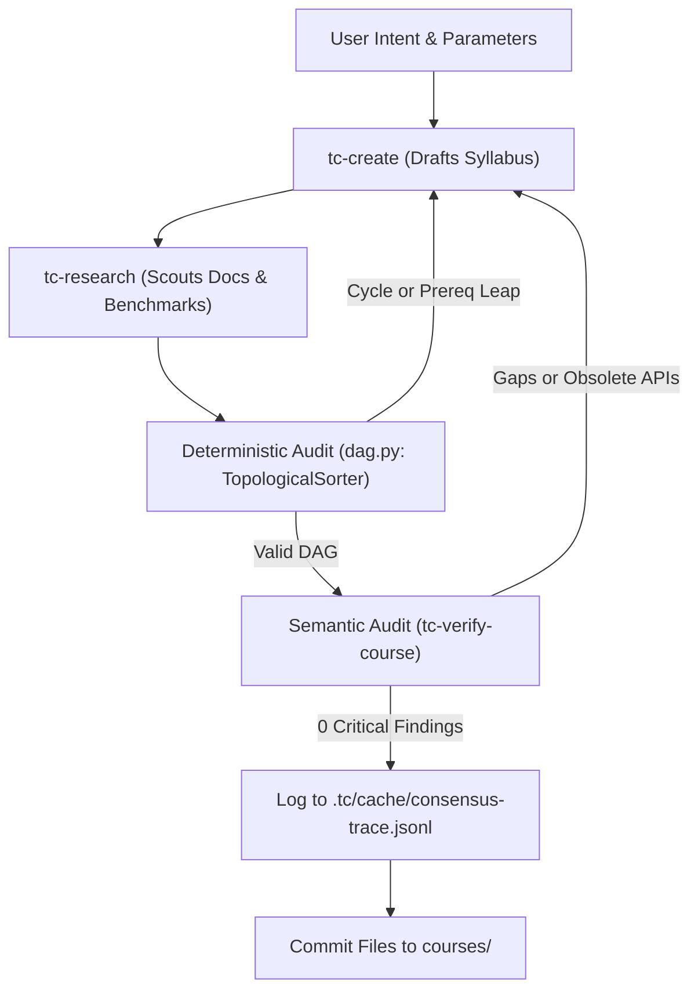

# Architecture Spine — TextCourses Framework

## Design Paradigm

TextCourses is architected as a **Hybrid Deterministic Substrate with Sovereign Filesystem-as-State**. It strictly separates system concerns into two decoupled planes:

1. **The Deterministic Substrate Layer (Python 3.11+ via `uv run`):**
   All state mutations, TOML manifest operations, JSONL ledger logging, graph topological sorting (DAG cycle audits), cryptographic SHA-256 hash calculations, and headless web extractions are executed by deterministic, self-contained Python scripts declaring dependencies via **PEP 723 inline script metadata**. The AI agent never manually hand-edits machine manifests or computes checksums; it executes deterministic CLI commands that guarantee schema integrity.

2. **The Pedagogical Conversational Layer (Markdown `SKILL.md`):**
   The AI agent prompt governs human-facing instructional delivery, Socratic reasoning, worked-example contrasts, diagnostic evaluation scenarios, tone matching, and the standardized Next-Action Fork protocol.

3. **Sovereign Filesystem-as-State:**
   There is zero reliance on remote databases, background daemon processes, or proprietary cloud accounts. All persistent state lives exclusively as standard files on the local filesystem across a dual-plane boundary: `.tc/` (internal machine state and decision traces), `research/<slug>/sources/` (sovereign local knowledge repository, SQLite FTS5 database, and synthesized catalog), and `roadmap/`, `courses/`, `portfolio/` (human-facing learning materials).



---

## Invariants & Rules

### AD-1 — Hybrid Deterministic Substrate
- **Binds:** All 9 `tc-*` skills and workspace operations (`FR-1` through `FR-23`).
- **Prevents:** LLM-induced manifest corruption, malformed JSONL records, broken TOML formatting, and hallucinated file paths.
- **Rule:** AI prompts in `SKILL.md` SHALL NEVER manually format or write machine-readable manifests (`course.toml`, `roadmap.toml`, `ledger.toml`) or append raw strings to `test-ledger.jsonl`. All state transitions, schema verifications, and ledger records MUST be executed by calling the corresponding deterministic Python script under `_tc/scripts/` via `uv run`.

### AD-2 — Two-Tier Script Architecture
- **Binds:** Script organization across the repository and user workspaces.
- **Prevents:** Script duplication, diverging schema implementations, and bloated skill distributions.
- **Rule:** Scripts are divided into exactly two tiers:
  1. **Core Runtime (`_tc/scripts/`):** Universal primitives shared across multiple skills (`manifest.py`, `ledger.py`, `dag.py`, `context.py`, `hash_tracker.py`). Deployed to every initialized learner workspace by `tc-init`.
  2. **Skill-Specific Scripts (`skills/tc-*/scripts/`):** Single-purpose tools belonging strictly to one capability (e.g. `skills/tc-research/scripts/scraper.py`, `skills/tc-verify-course/scripts/auditor.py`, `skills/tc-migrate/scripts/migrator.py`).
  Every script MUST declare inline PEP 723 dependency metadata (`# /// script ... # ///`) and require Python $\ge 3.11$.

### AD-3 — Atomic State Mutation & Compact Query Abstraction
- **Binds:** `manifest.py`, `ledger.py`, `course.toml`, `test-ledger.jsonl`.
- **Prevents:** Truncated file writes on process interruption, concurrent append race conditions, and context window bloat from loading raw log histories.
- **Rule:** 
  1. Manifest updates in `manifest.py` MUST write to a temporary file (`.tmp`), flush via `os.fsync()`, and perform an atomic `os.replace()` to overwrite the target TOML file.
  2. Appends to `test-ledger.jsonl` in `ledger.py` MUST acquire an exclusive file lock (`fcntl.flock` on POSIX systems), validate payload against a strict schema, and write atomically.
  3. Raw JSONL files SHALL NEVER be loaded directly into AI prompt context for reasoning. Skills MUST query `ledger.py summarize --course <slug>`, which returns a deduplicated, compact JSON summary of active misconceptions and weak sections under 100 tokens.

### AD-4 — Hybrid Triad Consensus Verification Pipeline
- **Binds:** `tc-create`, `tc-research`, `tc-verify-course` (`FR-6`, `FR-7`, `FR-8`).
- **Prevents:** Circular prerequisite dependencies, conceptual leaps, and ungrounded curricula written to disk.
- **Rule:** Course creation in `tc-create` SHALL NOT commit files to `courses/` until a two-stage pre-flight verification passes with zero critical findings:
  1. **Deterministic Stage (`dag.py`):** Builds a directed graph of all chapter and section prerequisites using `graphlib.TopologicalSorter`. Fails immediately on cycles or missing antecedent references at zero token cost.
  2. **Semantic Stage (`tc-verify-course`):** Audits proposed concepts against verified documentation digests in `.tc/research/<slug>/`.
  All consensus rounds, audit findings, and resolutions MUST be logged to `.tc/cache/consensus-trace.jsonl`.



### AD-5 — Enforceable Context Loading Matrix
- **Binds:** All 9 skills (`FR-22`).
- **Prevents:** Context degradation, prompt truncation, and token exhaustion on long courses.
- **Rule:** Every skill prompt MUST define a Stage Loading Table. Agents MUST execute explicit file reads strictly matching the table. Loading out-of-scope chapters, unneeded research, or raw ledgers is strictly forbidden:
  - `tc-teach`: Loads active `lesson-plan.md` (full), `preferences.md` (full), prior section notes (summary), rolling misconceptions (from `ledger.py`). OMMITS all other chapters and research files.
  - `tc-test-me`: Loads tested section `notes.md` (summary), active chapter test ledger slice. OMITS all `lesson-plan.md` files (preventing concept leaks).
  - `tc-practicals`: Loads `course.toml` (full), misconception summary (from `ledger.py`), `preferences.md` (full). OMITS lesson plans.

### AD-6 — Co-located Repository & Skill Distribution Architecture
- **Binds:** Project root repository topology and packaging.
- **Prevents:** Fractured tooling repositories, out-of-sync skill distributions, and complex multi-repo release overhead.
- **Rule:** The root repository (`text-courses-redesign`) hosts the entire TextCourses open-source distribution:
  - `skills/tc-*/` hosts the 9 installable skills.
  - `_tc/scripts/` hosts the canonical shared runtime template.
  - Deployed learner workspaces receive a local `_tc/scripts/` directory initialized on `/tc-init`.

### AD-7 — Completed Lesson Immutability & Non-Destructive Deprecation
- **Binds:** `tc-redirect-course`, `tc-teach` (`FR-20`).
- **Prevents:** Overwriting verified student notes, loss of learner reference material, and confusion between course versions.
- **Rule:** Once a section transitions to `status = "completed"` in `course.toml`, its `lesson-plan.md` and `notes.md` are bitwise immutable. If a course redirection introduces updated material:
  - `tc-redirect-course` MUST only append new sub-sections after the completed content.
  - If content is superseded, it MUST only prepend a non-destructive Markdown blockquote header to `notes.md` (`> ⚠️ Deprecation Marker: Superseded by Section X.Y`).

### AD-8 — Surface-Agnostic Public Contract
- **Binds:** All 10 skills and CLI utilities (`FR-23`).
- **Prevents:** Vendor lock-in to proprietary IDE extensions, cloud webhooks, or GUI dialogs.
- **Rule:** All skills, scripts, and commands MUST interact solely through standard POSIX filesystem paths, stdin/stdout, and universally parseable serializations (TOML, JSONL, Markdown). Any compliant agent harness with filesystem read/write access (Terminal CLI, VS Code, Cursor, JetBrains, or web wrappers) can execute the complete framework without adaptation.

### AD-9 — Universal Low-Cognitive-Load Interaction Plane
- **Binds:** All 10 skills, onboarding flows, and conversational faculties (`FR-42`).
- **Prevents:** Learner fatigue, cognitive paralysis from multi-question prompt dumping, jargon confusion, and excessive scrolling.
- **Rule:** 
  1. Every interactive turn MUST present strictly ONE question or menu decision, waiting for user response before asking the next.
  2. All prompts and options must adhere to the 10-year-old Plain English standard documented in `_tc/INTERACTION_STANDARDS.md`.
  3. Contextual choices dynamically display `(Recommended)` based on prior responses.
  4. For multi-part decisions, provide a final concise scannable summary with short answer codes so the learner never scrolls back and forth.

### AD-10 — Autonomous Multi-Source Deep Harvesting & Evidence Registry
- **Binds:** `tc-research`, `harvester.py`, `scout.py` (`FR-43`).
- **Prevents:** Hallucinated or shallow syllabi derived solely from LLM pre-training weights; ungrounded commercial book assumptions.
- **Rule:** 
  1. Marie Curie discovers community gold standards from Reddit/HN/university reading lists and logs them to `research/<slug>/gold-standards.md`.
  2. Open-source repositories and markdown textbooks on GitHub are cloned/downloaded into `research/<slug>/sources/repos/<repo_name>/`.
  3. Landmark YouTube lecture transcripts are extracted and cleaned via `harvest-youtube` into `research/<slug>/sources/transcripts/`.
  4. Proprietary commercial books trigger an explicit, gentle material acquisition gate with clear options: drop files into `sources/` or proceed with open documentation.

### AD-11 — Mandatory AI-Era Research Grounding & Universal Hat Dialectic
- **Binds:** `tc-research`, `scout.py` (`FR-44`).
- **Prevents:** Teaching deprecated pre-AI idioms, ignoring modern automated tooling, and vulnerability to AI hallucinations.
- **Rule:** 
  1. Every research dossier (`dossier.md`) and machine digest (`digest.json`) MUST include an AI-Era landscape analysis detailing automated routine boilerplate, AI-adjacent tools/APIs, and AI hallucination guardrails.
  2. The Universal Hat Registry provides 13 critical lenses, including `ai_pro_strategist` for AI augmentation and verification workflows.

### AD-12 — Potato-Proof Sovereign RAG Indexer & SQLite FTS5 Point Retrieval
- **Binds:** `tc-index`, `indexer.py`, `tc.py` (`FR-45.1`, `FR-45.3`, `FR-45.4`, `FR-45.5`).
- **Prevents:** Out-of-memory crashes on consumer laptops, heavy background daemon overhead, external API leaks, and slow semantic vector search.
- **Rule:** 
  1. Knowledge indexing executes entirely within a `<50MB RAM` ceiling using standard library `sqlite3` FTS5 with Porter stemming, zero external server daemons, and zero API keys.
  2. Indexing operates through 4 deterministic gates: Gate 1 (Scan & SHA-256), Gate 2 (Hierarchical Breadcrumb Chunking), Gate 3 (SQLite FTS5 & `catalog.json` generation), Gate 4 (Automated Probe Verification).
  3. BM25 point retrieval guarantees sub-15ms search latency with highlighted context snippets.

### AD-13 — Cross-Source Domain Catalog Synthesis & Unified Curriculum Invariant
- **Binds:** `tc-index`, `tc-create`, `course_builder.py`, `indexer.py` (`FR-45.2`).
- **Prevents:** Naive book-mirroring ("Book A Chapter 1, Book B Chapter 1"), fragmented curricula, and omission of consensus domain concepts.
- **Rule:** 
  1. `indexer.py` synthesizes `research/<slug>/sources/catalog.json`, containing consensus-ranked canonical topics, code identifiers, and prerequisite vocabulary across all ingested textbooks, repos, and transcripts.
  2. `/tc-create` MUST ingest `catalog.json` during the Triad Consensus Dialectic. Daedalus drafts ONE unified master course synthesized across all sources, verified by Denis Diderot with an affirmative vote.

---

## Consistency Conventions

| Concern | Convention |
| --- | --- |
| **Directory Slugs** | Strict `kebab-case` with sequential two-digit zero-padded prefixes: `course-01-<slug>`, `chapter-01-<slug>`, `section-01-<slug>`, `project-01-<slug>`. |
| **Configuration Files** | Standard `TOML` (`course.toml`, `roadmap.toml`, `ledger.toml`, `customize.toml`, `config.json`). Always formatted with 2-space or 4-space standard indentation. |
| **Assessment & Audit Logs** | `JSONL` (`test-ledger.jsonl`, `consensus-trace.jsonl`). Each row is an independent, valid single-line JSON object terminated by `\n`. |
| **Human Notes & Specs** | GitHub-Flavored `Markdown` (`notes.md`, `lesson-plan.md`, `overview.md`, `project-spec.md`, `review-report.md`). Standard Markdown tables, bolded terms, no raw HTML tags. |
| **Diagnostic Error Codes** | `SCREAMING_SNAKE_CASE` strings prefixed by failure domain: `CONFUSION_<TOPIC>`, `MISCONCEPTION_<TOPIC>`, `BOUNDARY_VIOLATION_<TOPIC>`. |
| **Section Status Lifecycle** | Finite state transitions in `course.toml`: `not_started` ➔ `in_progress` ➔ `review` ➔ `completed`. |
| **Script Exit Codes** | `0` for clean execution (prints JSON payload to stdout); non-zero (`1` or `2`) on validation failure (prints `{"ok": false, "error": "..."}` to stderr). |

---

## Stack

| Name | Version | Role in TextCourses |
| --- | --- | --- |
| **Python** | `>=3.11` | Primary runtime for all deterministic substrate scripts (`_tc/scripts/*.py`). |
| **uv** | `>=0.4.0` | Fast Python runner executing scripts with inline PEP 723 metadata without pre-created virtualenvs. |
| **sqlite3** | Python stdlib (`3.11+`) | Native FTS5 full-text search with Porter stemmer powering potato-proof local RAG engine under 50MB RAM (`indexer.py`). |
| **tomli / tomllib** | Python stdlib (`3.11+`) | Native TOML parser for manifests (`course.toml`, `roadmap.toml`, `ledger.toml`). |
| **tomli-w** | `>=1.0.0` | Deterministic TOML serializer for atomic manifest writing. |
| **pydantic** | `>=2.8.0` | Data validation and schema enforcement for `test-ledger.jsonl` entries and pre-flight audit reports. |
| **trafilatura** | `>=1.12.0` | Resilient, headless web text and readability extractor in `tc-research` scout. |
| **yt-dlp** | Optional CLI | Landmark YouTube lecture transcript and subtitle extraction in `harvester.py`. |
| **graphlib** | Python stdlib (`3.11+`) | Native topological sorting and cycle detection for prerequisite DAGs in `dag.py`. |
| **fcntl** | POSIX stdlib | Cross-process file locking for atomic appends in `ledger.py` and `course_builder.py`. |

---

## Structural Seed

### 1. Repository Structure (`text-courses-redesign`)

```text
text-courses-redesign/
├── README.md                          # Framework overview & quick-start guide
├── pyproject.toml                     # Python package metadata & test runner configs
├── skills-lock.json                   # Agent skill manifest lockfile
├── _tc/                               # Canonical shared runtime engine template
│   ├── INTERACTION_STANDARDS.md       # Zero-cognitive-overload, 1-question turn limits, kid-friendly UX
│   ├── config.default.json            # Default framework configuration
│   └── scripts/
│       ├── tc.py                      # Unified CLI entrypoint & dispatcher (all 20 modules)
│       ├── indexer.py                 # Potato-proof SQLite FTS5 RAG indexer & catalog synthesizer
│       ├── harvester.py               # Autonomous GitHub & YouTube deep asset harvester
│       ├── scout.py                   # Autonomous 5/13-hat deep research engine
│       ├── course_builder.py          # Triad Consensus dialectic & non-mirroring catalog integration
│       ├── bootstrapper.py            # Workspace initialization & scanner
│       ├── teach_engine.py            # Socratic instruction & session state machine
│       ├── notes_compiler.py          # Flat textbook compiler & zero-jargon auditor
│       ├── practical_evaluator.py     # Applied challenge generator & 4-lens reviewer
│       ├── diagnostic_tester.py       # Bloom taxonomy diagnostic inquiry engine
│       ├── manifest.py                # Atomic TOML manifest manager
│       ├── ledger.py                  # Atomic JSONL test ledger manager & query summarizer
│       ├── dag.py                     # Topological DAG validator & cycle checker
│       ├── context.py                 # Context manifest loader & budget enforcement
│       ├── hash_tracker.py            # Resilient cross-platform SHA-256 delta tracker
│       ├── memlog.py                  # Two-tier token-minimal pedagogical memory logger
│       ├── auditor.py                 # Structural integrity & link verification
│       ├── redirector.py              # Dynamic in-flight course mutations & deprecation manager
│       ├── migrator.py                # Consent-gated schema migrator
│       └── lesson_tracker.py          # Checklist progress tracker
├── skills/                            # The 10 canonical skill packages
│   ├── tc-init/                       # Chiron onboarding & workspace bootstrap
│   ├── tc-research/                   # Marie Curie autonomous deep research engine
│   ├── tc-index/                      # Denis Diderot sovereign knowledge indexer & catalog synthesizer
│   ├── tc-create/                     # Daedalus curriculum architect & Triad consensus
│   ├── tc-teach/                      # Socratic instruction & master faculty tutoring
│   ├── tc-roadmap/                    # Macro learning roadmap & prerequisite trajectory
│   ├── tc-verify-course/              # Pre-flight curriculum auditor
│   ├── tc-test-me/                    # Question-based diagnostic evaluator
│   ├── tc-practicals/                 # Applied challenge evaluator & 4-lens reviewer
│   ├── tc-redirect-course/            # In-flight course mutation manager
│   └── tc-migrate/                    # Layout migrator & health checker
└── tests/                             # Comprehensive test suite (254 tests)
    ├── test_indexer.py                # FTS5 schema, chunking, catalog, memory budget tests
    ├── test_harvester.py              # Multi-source harvesting & transcript tests
    ├── test_five_hat_research.py      # Universal hat research engine tests
    └── ...
```

### 2. Generated Learner Workspace Structure

```text
<learner-workspace-root>/
├── .tc/                               # Internal runtime, caches & decision logs
│   ├── config.json                    # Workspace metadata & local settings
│   └── cache/                         # Empirical decision traces & audit logs
│       ├── consensus-trace.jsonl      # Record of Triad Consensus reconciliations
│       └── audit-preflight.json       # Latest pre-flight audit report
├── _tc/                               # Deployed deterministic runtime scripts
│   ├── INTERACTION_STANDARDS.md       # Interaction standards reference
│   └── scripts/                       # 20 self-contained executable Python modules
├── profile/                           # Sovereign learner profile & global memory
│   ├── preferences.md                 # Learner background, role, and active teacher persona
│   └── memlog.md                      # Append-only global pedagogical milestone timeline
├── roadmap/                           # Macro curricular cockpit
│   ├── roadmap.md                     # Human-readable milestone progression
│   └── roadmap.toml                   # Machine-readable macro prerequisite graph
├── research/                          # Autonomous research substrate
│   └── <topic-slug>/
│       ├── gold-standards.md          # Community consensus books & landmark lectures
│       ├── dossier.md                 # Comprehensive knowledge map & AI-era landscape
│       ├── multi-hats-critique.md     # Universal multi-perspective dialectic review
│       ├── sources.json               # Full provenance citations and harvest records
│       ├── digest.json                # Extracted ToC, symbols, and prerequisite vocabulary
│       └── sources/                   # Sovereign Local Knowledge Substrate
│           ├── repos/                 # Cloned open textbook GitHub repositories
│           ├── transcripts/           # Cleaned landmark lecture transcripts
│           ├── index.db               # Sovereign SQLite FTS5 database (sub-15ms BM25)
│           └── catalog.json           # Synthesized master domain taxonomy
├── courses/                           # Generated living textbooks
│   └── course-01-<slug>/
│       ├── course.toml                # Course manifest & section status tracker
│       ├── memlog.md                  # Course-level session memory & concept log
│       ├── consensus-deliberation.md  # Multi-critic debate transcript
│       ├── curriculum-brainstorm.md   # Multi-path architectural trade-off evaluation
│       ├── overview.md                # Syllabus, chosen archetype & prerequisite DAG
│       ├── notes/                     # Flat readable textbook chapters
│       │   ├── chapter-01.md
│       │   └── chapter-02.md
│       └── chapter-01-<slug>/
│           └── section-01-<slug>/
│               ├── lesson-plan.md     # Instructor concept checklist
│               └── notes.md           # Distilled reference textbook notes
└── portfolio/                         # Practical proof-of-work project deliverables
    └── <slug>-project/
        ├── project-spec.md            # Concrete challenge requirements & test contracts
        ├── review-report.md           # 4-lens evaluation report
        └── workspace/                 # Student's verified runnable code
```

---

## Capability → Architecture Map

| Capability / Requirement | Component / Module | Governed by |
| --- | --- | --- |
| **FR-1, FR-2, FR-3** (Intake, Styles, Scanner) | `skills/tc-init/`, `_tc/scripts/bootstrapper.py` | AD-1, AD-2, AD-8 |
| **FR-4, FR-5** (5 Archetypes, User Curriculum) | `skills/tc-create/`, `_tc/scripts/course_builder.py` | AD-1, AD-4 |
| **FR-6** (Research Fallback & Confidence Scoring) | `skills/tc-research/`, `_tc/scripts/scout.py` | AD-1, AD-2 |
| **FR-7, FR-8** (Pre-Flight Audit & Triad Loop) | `skills/tc-verify-course/`, `_tc/scripts/auditor.py` | AD-1, AD-4 |
| **FR-9, FR-10** (Single Concept, Next-Action Fork)| `skills/tc-teach/`, `_tc/scripts/teach_engine.py` | AD-5, AD-8 |
| **FR-11, FR-12** (Auto Notes Compilation, Compaction) | `skills/tc-teach/`, `_tc/scripts/notes_compiler.py` | AD-1, AD-3, AD-7 |
| **FR-13, FR-14, FR-15** (Diagnostic Testing, Ledger) | `skills/tc-test-me/`, `_tc/scripts/ledger.py` | AD-1, AD-3, AD-5 |
| **FR-16, FR-17, FR-18** (Practicals & 4-Lens Review) | `skills/tc-practicals/`, `practical_evaluator.py` | AD-1, AD-3, AD-5 |
| **FR-19, FR-20** (Hash Tracking, Immutability) | `skills/tc-redirect-course/`, `hash_tracker.py` | AD-1, AD-2, AD-7 |
| **FR-21** (Consent-Gated Schema Migration) | `skills/tc-migrate/`, `scripts/migrator.py` | AD-1, AD-2, AD-8 |
| **FR-22** (Context Loading Matrix) | `_tc/scripts/context.py`, all `SKILL.md` files | AD-5 |
| **FR-23** (AI-Harness Agnosticism) | All skills & runtime scripts | AD-8 |
| **FR-24, FR-25** (Faculty Personas & Macro Roadmap) | `skills/tc-roadmap/`, `_tc/scripts/manifest.py` | AD-1, AD-8 |
| **FR-26, FR-27** (Pedagogical Memlog & Clean Layout) | `_tc/scripts/memlog.py`, `bootstrapper.py` | AD-1, AD-3 |
| **FR-30, FR-31** (5-Hat Research & Triad Dialectic) | `skills/tc-research/`, `course_builder.py` | AD-4, AD-10 |
| **FR-34, FR-35** (Pedagogical Brainstorm & Practicals) | `course_builder.py`, `practical_evaluator.py` | AD-4, AD-8 |
| **FR-38, FR-39** (Unified Dispatcher & Session State) | `_tc/scripts/tc.py`, `teach_engine.py` | AD-1, AD-8 |
| **FR-42** (Universal Low-Cognitive-Load Pacing) | `_tc/INTERACTION_STANDARDS.md`, `tc-init` | AD-9 |
| **FR-43** (Multi-Source Deep Harvester & Consensus) | `skills/tc-research/`, `_tc/scripts/harvester.py` | AD-10 |
| **FR-44** (AI-Era Research Grounding & AI-Pro Hat) | `skills/tc-research/`, `_tc/scripts/scout.py` | AD-11 |
| **FR-45** (Potato-Proof Sovereign RAG & Catalog) | `skills/tc-index/`, `_tc/scripts/indexer.py` | AD-12, AD-13 |

---

## Deferred

The following architectural dimensions are intentionally deferred to post-v1 releases:

1. **Automated Spaced Repetition Scheduling Engine:**
   - *Reason Deferred:* In v1, active recall is strictly on-demand via `/tc-test-me`. Timestamp-based interval calculation across `test-ledger.jsonl` will be introduced in v2 without breaking current ledger schemas.
2. **Public Blueprint Cloud Registry (`textcourses.com`):**
   - *Reason Deferred:* v1 focuses on local-first generation and sovereignty. Cloud syllabus sharing and cryptographic portfolio signing require centralized infrastructure deferred to v2.
3. **Multi-Learner Cohort Syncing:**
   - *Reason Deferred:* TextCourses is calibrated for deep autonomous individual learners and mentors. Synchronous multi-user git state synchronization is deferred.
4. **GUI / Web Dashboard Interface:**
   - *Reason Deferred:* Editor/CLI and agent harnesses provide the distraction-free build substrate. A graphical web viewer is a downstream companion tool.
