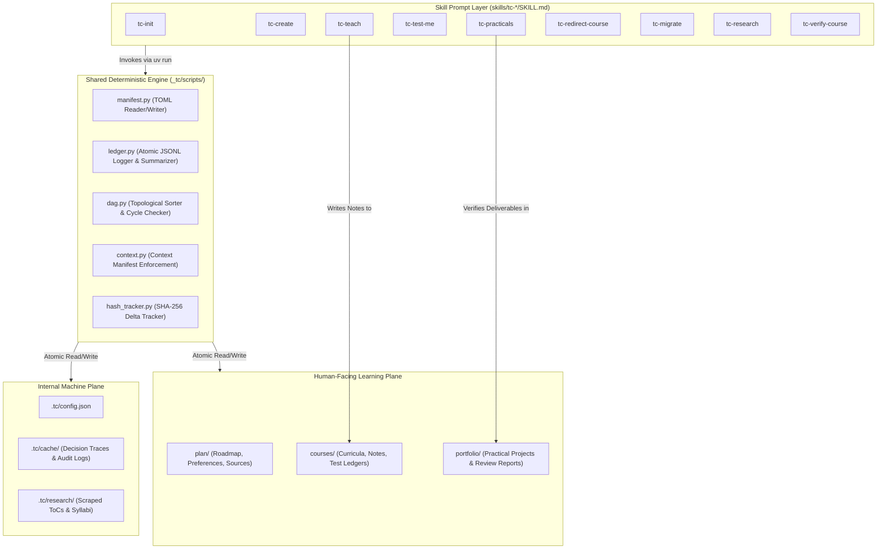
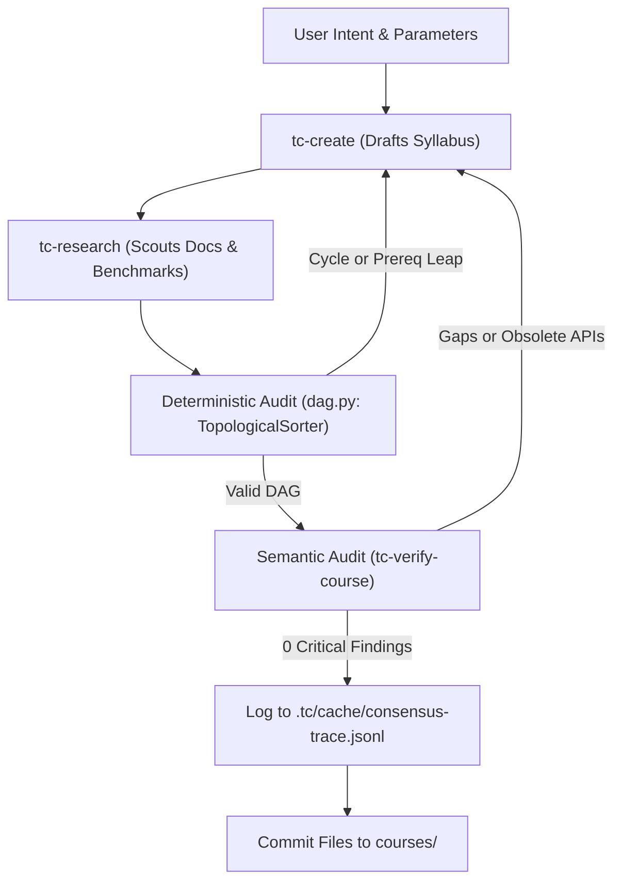

# Architecture Spine — TextCourses Framework

## Design Paradigm

TextCourses is architected as a **Hybrid Deterministic Substrate with Sovereign Filesystem-as-State**. It strictly separates system concerns into two decoupled planes:

1. **The Deterministic Substrate Layer (Python 3.11+ via `uv run`):**
   All state mutations, TOML manifest operations, JSONL ledger logging, graph topological sorting (DAG cycle audits), cryptographic SHA-256 hash calculations, and headless web extractions are executed by deterministic, self-contained Python scripts declaring dependencies via **PEP 723 inline script metadata**. The AI agent never manually hand-edits machine manifests or computes checksums; it executes deterministic CLI commands that guarantee schema integrity.

2. **The Pedagogical Conversational Layer (Markdown `SKILL.md`):**
   The AI agent prompt governs human-facing instructional delivery, Socratic reasoning, worked-example contrasts, diagnostic evaluation scenarios, tone matching, and the standardized Next-Action Fork protocol.

3. **Sovereign Filesystem-as-State:**
   There is zero reliance on remote databases, background daemon processes, or proprietary cloud accounts. All persistent state lives exclusively as standard files on the local filesystem across a dual-plane boundary: `.tc/` (internal machine state and decision traces) and `plan/`, `courses/`, `portfolio/` (human-facing learning materials).



---

## Invariants & Rules

### AD-1 — Hybrid Deterministic Substrate
- **Binds:** All 9 `tc-*` skills and workspace operations (`FR-1` through `FR-23`).
- **Prevents:** LLM-induced manifest corruption, malformed JSONL records, broken TOML formatting, and hallucinated file paths.
- **Rule:** AI prompts in `SKILL.md` SHALL NEVER manually format or write machine-readable manifests (`course.toml`, `roadmap.toml`, `ledger.toml`) or append raw strings to `test-ledger.jsonl`. All state transitions, schema verifications, and ledger records MUST be executed by calling the corresponding deterministic Python script under `_tc/scripts/` via `uv run`.

### AD-2 — Two-Tier Script Architecture
- **Binds:** Script organization across the repository and user workspaces.
- **Prevents:** Script duplication, diverging schema implementations, and bloated skill distributions.
- **Rule:** Scripts are divided into exactly two tiers:
  1. **Core Runtime (`_tc/scripts/`):** Universal primitives shared across multiple skills (`manifest.py`, `ledger.py`, `dag.py`, `context.py`, `hash_tracker.py`). Deployed to every initialized learner workspace by `tc-init`.
  2. **Skill-Specific Scripts (`skills/tc-*/scripts/`):** Single-purpose tools belonging strictly to one capability (e.g. `skills/tc-research/scripts/scraper.py`, `skills/tc-verify-course/scripts/auditor.py`, `skills/tc-migrate/scripts/migrator.py`).
  Every script MUST declare inline PEP 723 dependency metadata (`# /// script ... # ///`) and require Python $\ge 3.11$.

### AD-3 — Atomic State Mutation & Compact Query Abstraction
- **Binds:** `manifest.py`, `ledger.py`, `course.toml`, `test-ledger.jsonl`.
- **Prevents:** Truncated file writes on process interruption, concurrent append race conditions, and context window bloat from loading raw log histories.
- **Rule:** 
  1. Manifest updates in `manifest.py` MUST write to a temporary file (`.tmp`), flush via `os.fsync()`, and perform an atomic `os.replace()` to overwrite the target TOML file.
  2. Appends to `test-ledger.jsonl` in `ledger.py` MUST acquire an exclusive file lock (`fcntl.flock` on POSIX systems), validate payload against a strict schema, and write atomically.
  3. Raw JSONL files SHALL NEVER be loaded directly into AI prompt context for reasoning. Skills MUST query `ledger.py summarize --course <slug>`, which returns a deduplicated, compact JSON summary of active misconceptions and weak sections under 100 tokens.

### AD-4 — Hybrid Triad Consensus Verification Pipeline
- **Binds:** `tc-create`, `tc-research`, `tc-verify-course` (`FR-6`, `FR-7`, `FR-8`).
- **Prevents:** Circular prerequisite dependencies, conceptual leaps, and ungrounded curricula written to disk.
- **Rule:** Course creation in `tc-create` SHALL NOT commit files to `courses/` until a two-stage pre-flight verification passes with zero critical findings:
  1. **Deterministic Stage (`dag.py`):** Builds a directed graph of all chapter and section prerequisites using `graphlib.TopologicalSorter`. Fails immediately on cycles or missing antecedent references at zero token cost.
  2. **Semantic Stage (`tc-verify-course`):** Audits proposed concepts against verified documentation digests in `.tc/research/<slug>/`.
  All consensus rounds, audit findings, and resolutions MUST be logged to `.tc/cache/consensus-trace.jsonl`.



### AD-5 — Enforceable Context Loading Matrix
- **Binds:** All 9 skills (`FR-22`).
- **Prevents:** Context degradation, prompt truncation, and token exhaustion on long courses.
- **Rule:** Every skill prompt MUST define a Stage Loading Table. Agents MUST execute explicit file reads strictly matching the table. Loading out-of-scope chapters, unneeded research, or raw ledgers is strictly forbidden:
  - `tc-teach`: Loads active `lesson-plan.md` (full), `preferences.md` (full), prior section notes (summary), rolling misconceptions (from `ledger.py`). OMMITS all other chapters and research files.
  - `tc-test-me`: Loads tested section `notes.md` (summary), active chapter test ledger slice. OMITS all `lesson-plan.md` files (preventing concept leaks).
  - `tc-practicals`: Loads `course.toml` (full), misconception summary (from `ledger.py`), `preferences.md` (full). OMITS lesson plans.

### AD-6 — Co-located Repository & Skill Distribution Architecture
- **Binds:** Project root repository topology and packaging.
- **Prevents:** Fractured tooling repositories, out-of-sync skill distributions, and complex multi-repo release overhead.
- **Rule:** The root repository (`text-courses-redesign`) hosts the entire TextCourses open-source distribution:
  - `skills/tc-*/` hosts the 9 installable skills.
  - `_tc/scripts/` hosts the canonical shared runtime template.
  - Deployed learner workspaces receive a local `_tc/scripts/` directory initialized on `/tc-init`.

### AD-7 — Completed Lesson Immutability & Non-Destructive Deprecation
- **Binds:** `tc-redirect-course`, `tc-teach` (`FR-20`).
- **Prevents:** Overwriting verified student notes, loss of learner reference material, and confusion between course versions.
- **Rule:** Once a section transitions to `status = "completed"` in `course.toml`, its `lesson-plan.md` and `notes.md` are bitwise immutable. If a course redirection introduces updated material:
  - `tc-redirect-course` MUST only append new sub-sections after the completed content.
  - If content is superseded, it MUST only prepend a non-destructive Markdown blockquote header to `notes.md` (`> ⚠️ Deprecation Marker: Superseded by Section X.Y`).

### AD-8 — Surface-Agnostic Public Contract
- **Binds:** All 9 skills and CLI utilities (`FR-23`).
- **Prevents:** Vendor lock-in to proprietary IDE extensions, cloud webhooks, or GUI dialogs.
- **Rule:** All skills, scripts, and commands MUST interact solely through standard POSIX filesystem paths, stdin/stdout, and universally parseable serializations (TOML, JSONL, Markdown). Any compliant agent harness with filesystem read/write access (Terminal CLI, VS Code, Cursor, JetBrains, or web wrappers) can execute the complete framework without adaptation.

---

## Consistency Conventions

| Concern | Convention |
| --- | --- |
| **Directory Slugs** | Strict `kebab-case` with sequential two-digit zero-padded prefixes: `course-01-<slug>`, `chapter-01-<slug>`, `section-01-<slug>`, `project-01-<slug>`. |
| **Configuration Files** | Standard `TOML` (`course.toml`, `roadmap.toml`, `ledger.toml`, `customize.toml`, `config.json`). Always formatted with 2-space or 4-space standard indentation. |
| **Assessment & Audit Logs** | `JSONL` (`test-ledger.jsonl`, `consensus-trace.jsonl`). Each row is an independent, valid single-line JSON object terminated by `\n`. |
| **Human Notes & Specs** | GitHub-Flavored `Markdown` (`notes.md`, `lesson-plan.md`, `overview.md`, `project-spec.md`, `review-report.md`). Standard Markdown tables, bolded terms, no raw HTML tags. |
| **Diagnostic Error Codes** | `SCREAMING_SNAKE_CASE` strings prefixed by failure domain: `CONFUSION_<TOPIC>`, `MISCONCEPTION_<TOPIC>`, `BOUNDARY_VIOLATION_<TOPIC>`. |
| **Section Status Lifecycle** | Finite state transitions in `course.toml`: `not_started` ➔ `in_progress` ➔ `review` ➔ `completed`. |
| **Script Exit Codes** | `0` for clean execution (prints JSON payload to stdout); non-zero (`1` or `2`) on validation failure (prints `{"ok": false, "error": "..."}` to stderr). |

---

## Stack

| Name | Version | Role in TextCourses |
| --- | --- | --- |
| **Python** | `>=3.11` | Primary runtime for all deterministic substrate scripts (`_tc/scripts/*.py`). |
| **uv** | `>=0.4.0` | Fast Python runner executing scripts with inline PEP 723 metadata without pre-created virtualenvs. |
| **tomli / tomllib** | Python stdlib (`3.11+`) | Native TOML parser for manifests (`course.toml`, `roadmap.toml`, `ledger.toml`). |
| **tomli-w** | `>=1.0.0` | Deterministic TOML serializer for atomic manifest writing. |
| **pydantic** | `>=2.8.0` | Data validation and schema enforcement for `test-ledger.jsonl` entries and pre-flight audit reports. |
| **trafilatura** | `>=1.12.0` | Resilient, headless web text and readability extractor in `tc-research` scraper. |
| **graphlib** | Python stdlib (`3.11+`) | Native topological sorting and cycle detection for prerequisite DAGs in `dag.py`. |
| **fcntl** | POSIX stdlib | Cross-process file locking for atomic appends in `ledger.py`. |

---

## Structural Seed

### 1. Repository Structure (`text-courses-redesign`)

```text
text-courses-redesign/
├── README.md                          # Framework overview & quick-start guide
├── pyproject.toml                     # Python package metadata & test runner configs
├── skills-lock.json                   # Agent skill manifest lockfile
├── _tc/                               # Canonical shared runtime engine template
│   ├── config.default.json            # Default framework configuration
│   └── scripts/
│       ├── manifest.py                # Atomic TOML manifest manager
│       ├── ledger.py                  # Atomic JSONL test ledger manager & query summarizer
│       ├── dag.py                     # Topological DAG validator & cycle checker
│       ├── context.py                 # Context manifest loader & budget enforcement
│       └── hash_tracker.py            # SHA-256 source delta hash tracker
├── skills/                            # The 9 canonical skill packages
│   ├── tc-init/
│   │   ├── SKILL.md                   # Intake, style picker & workspace bootstrap
│   │   ├── customize.toml             # Overridable intake options & preferences
│   │   └── assets/                    # Preview style samples & templates
│   ├── tc-create/
│   │   ├── SKILL.md                   # Curriculum architect & Triad loop driver
│   │   ├── customize.toml             # Archetype definitions & depth defaults
│   │   └── assets/archetypes.json     # Archetype structural scaffolds
│   ├── tc-research/
│   │   ├── SKILL.md                   # Web intelligence scout
│   │   ├── customize.toml             # Search engines & fallback tier configs
│   │   └── scripts/scraper.py         # Headless doc extractor via trafilatura
│   ├── tc-teach/
│   │   ├── SKILL.md                   # Single-concept conversational tutor & notes compiler
│   │   └── customize.toml             # Pacing & Next-Action Fork defaults
│   ├── tc-verify-course/
│   │   ├── SKILL.md                   # Pre-flight curriculum auditor
│   │   └── scripts/auditor.py         # Deterministic consistency rule checks
│   ├── tc-test-me/
│   │   ├── SKILL.md                   # 100% question-based diagnostic evaluator
│   │   └── customize.toml             # Hinge question generation rubrics
│   ├── tc-practicals/
│   │   ├── SKILL.md                   # Project generator & 4-lens reviewer
│   │   └── assets/lenses/             # Review lenses: functional, edge, craft, verify
│   ├── tc-redirect-course/
│   │   ├── SKILL.md                   # Change manager & non-destructive deprecation
│   │   └── customize.toml             # Delta threshold rules
│   └── tc-migrate/
│       ├── SKILL.md                   # Workspace health checker & consent-gated migrator
│       └── scripts/migrator.py        # Schema migrator & dry-run planner
└── tests/                             # Test suite for runtime scripts
    ├── test_manifest.py
    ├── test_ledger.py
    ├── test_dag.py
    └── test_hash_tracker.py
```

### 2. Generated Learner Workspace Structure

```text
<learner-workspace-root>/
├── .tc/                               # Internal runtime, caches & scraping data
│   ├── config.json                    # Workspace metadata & local settings
│   ├── cache/                         # Empirical decision traces & audit logs (preserved)
│   │   ├── consensus-trace.jsonl      # Record of Triad Consensus reconciliations
│   │   └── audit-preflight.json       # Latest pre-flight audit report
│   └── research/                      # Scraped intelligence (ToCs, benchmarks)
│       └── <topic-slug>/
│           ├── metadata.json          # Search queries, source URLs, confidence score
│           └── curriculum-digest.md   # Synthesized outline & canonical syllabus
├── _tc/                               # Deployed deterministic runtime scripts
│   └── scripts/
│       ├── manifest.py
│       ├── ledger.py
│       ├── dag.py
│       ├── context.py
│       └── hash_tracker.py
├── plan/                              # User-facing strategic cockpit
│   ├── roadmap.md                     # Macro learning trajectory
│   ├── roadmap.toml                   # Machine-readable roadmap status tracker
│   ├── preferences.md                 # Learner intake, background & evolvable style profile
│   └── sources/                       # Raw reference inputs & user notes
│       └── ledger.toml                # Cryptographic SHA-256 hash tracker
└── courses/                           # Generated living textbooks
    └── course-01-<slug>/
        ├── course.toml                # Course manifest & section status tracker
        ├── test-ledger.jsonl          # Persistent question-based assessment history
        ├── overview.md                # Syllabus, chosen archetype & prerequisite DAG
        ├── portfolio/                 # Verifiable human proof-of-work deliverables
        │   └── project-01-<slug>/
        │       ├── project-spec.md    # Deterministic deliverable requirements & test contracts
        │       ├── review-report.md   # Multi-lens review evaluation report
        │       └── workspace/         # Learner's project code & test implementations
        └── chapter-01-<slug>/
            ├── chapter-overview.md    # Chapter objectives & topic index
            └── section-01-<slug>/
                ├── lesson-plan.md     # Instructor concept checklist (AI eyes only)
                └── notes.md           # Distilled student reference textbook (post-completion)
```

---

## Capability → Architecture Map

| Capability / Requirement | Component / Module | Governed by |
| --- | --- | --- |
| **FR-1, FR-2, FR-3** (Intake, Styles, Scanner) | `skills/tc-init/`, `_tc/scripts/manifest.py` | AD-1, AD-2, AD-8 |
| **FR-4, FR-5** (5 Archetypes, User Curriculum) | `skills/tc-create/`, `_tc/scripts/dag.py` | AD-1, AD-4 |
| **FR-6** (Research Fallback & Confidence Scoring) | `skills/tc-research/`, `scripts/scraper.py` | AD-1, AD-2 |
| **FR-7, FR-8** (Pre-Flight Audit & Triad Loop) | `skills/tc-verify-course/`, `_tc/scripts/dag.py` | AD-1, AD-4 |
| **FR-9, FR-10** (Single Concept, Next-Action Fork)| `skills/tc-teach/SKILL.md` | AD-5, AD-8 |
| **FR-11, FR-12** (Auto Notes Compilation, Compaction) | `skills/tc-teach/`, `_tc/scripts/manifest.py` | AD-1, AD-3, AD-7 |
| **FR-13, FR-14, FR-15** (Diagnostic Testing, Ledger) | `skills/tc-test-me/`, `_tc/scripts/ledger.py` | AD-1, AD-3, AD-5 |
| **FR-16, FR-17, FR-18** (Practicals & 4-Lens Review) | `skills/tc-practicals/`, `_tc/scripts/ledger.py`| AD-1, AD-3, AD-5 |
| **FR-19, FR-20** (Hash Tracking, Immutability) | `skills/tc-redirect-course/`, `hash_tracker.py` | AD-1, AD-2, AD-7 |
| **FR-21** (Consent-Gated Schema Migration) | `skills/tc-migrate/`, `scripts/migrator.py` | AD-1, AD-2, AD-8 |
| **FR-22** (Context Loading Matrix) | `_tc/scripts/context.py`, all `SKILL.md` files | AD-5 |
| **FR-23** (AI-Harness Agnosticism) | All skills & runtime scripts | AD-8 |

---

## Deferred

The following architectural dimensions are intentionally deferred to post-v1 releases:

1. **Automated Spaced Repetition Scheduling Engine:**
   - *Reason Deferred:* In v1, active recall is strictly on-demand via `/tc-test-me`. Timestamp-based interval calculation across `test-ledger.jsonl` will be introduced in v2 without breaking current ledger schemas.
2. **Public Blueprint Cloud Registry (`textcourses.com`):**
   - *Reason Deferred:* v1 focuses on local-first generation and sovereignty. Cloud syllabus sharing and cryptographic portfolio signing require centralized infrastructure deferred to v2.
3. **Multi-Learner Cohort Syncing:**
   - *Reason Deferred:* TextCourses is calibrated for deep autonomous individual learners and mentors. Synchronous multi-user git state synchronization is deferred.
4. **GUI / Web Dashboard Interface:**
   - *Reason Deferred:* Editor/CLI and agent harnesses provide the distraction-free build substrate. A graphical web viewer is a downstream companion tool.
