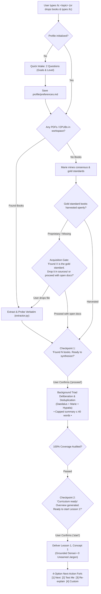

# Interaction Flowchart: Interactive Checkpoint Gates & Acquisition Loop

> **Companion to**: `spec-consumer-ux-and-unified-tc.md`  
> **Purpose**: Map the step-by-step interactive gates, missing-material acquisition pause, and conversational teaching loop under the single `/tc` front door.

---

## 1. Unified Dispatch & Step-by-Step Interactive Gates

Every user interaction flows through `/tc`. Rather than steamrolling unattended through multiple phases, `/tc` asks for user confirmation at load-bearing pedagogical checkpoints:



---

## 2. The Three Load-Bearing Human Checkpoints

### Checkpoint 1: Material Acquisition & Sourcing Pause
* **Trigger**: Research discovers that a landmark, gold-standard textbook (e.g. *Designing Data-Intensive Applications*) is proprietary and cannot be auto-cloned from open GitHub repos.
* **Interactive Behavior**: System pauses and offers two simple, clean choices:
  > *"📚 Gold Standard Found: Martin Kleppmann's **Designing Data-Intensive Applications** is the community-consensus book for this topic.*  
  > *If you have a copy (PDF or EPUB), drop it anywhere into this workspace, and I'll compile it into your course.*  
  > *Or simply type `1` to proceed using official documentation, lecture transcripts, and open repositories."*

### Checkpoint 2: Curriculum Approval Gate
* **Trigger**: Multi-source macro TOC alignment and deduplication are complete.
* **Interactive Behavior**: System presents the high-level roadmap and the concise $\le 40$-word deliberation summary:
  > *"🏛️ Daedalus, 🔬 Marie, and ⚖️ Hypatia synthesized your materials into a 4-chapter roadmap, deduplicating LSM-trees and 2PC while verifying 100% textbook coverage in the background.*  
  > 
  > **Distributed Storage Internals** (4 Chapters • 12 Sections)  
  > - Chapter 1: System Foundations & Storage Models  
  > - Chapter 2: LSM Storage Engines & B-Trees (Dialectic Synthesis)  
  > - Chapter 3: In-Memory Concurrency & Bw-Trees  
  > - Chapter 4: Distributed Transactions: Two-Phase Commit  
  > 
  > *Ready to begin Chapter 1? Type `1` to start or suggest any adjustments."*

### Checkpoint 3: Next-Action Fork (The Lesson Loop)
* **Trigger**: Conclusion of every single instructional turn.
* **Interactive Behavior**:
  ```markdown
  ---
  ### Next Action Fork
  - `[1]` **Next Concept**: Advance to the next concept in the lesson plan.
  - `[2]` **Test Me**: Challenge me with a diagnostic inquiry on this concept.
  - `[3]` **Re-explain / Deeper**: Provide an alternate angle, analogy, or edge case breakdown.
  - `[4]` **Custom**: Ask a specific question or explore a custom edge case.
  ```
  - Responds immediately to numeric inputs (`1`, `2`, `3`, `4`).
  - Responds with natural empathy if the user asks a conversational follow-up question.
