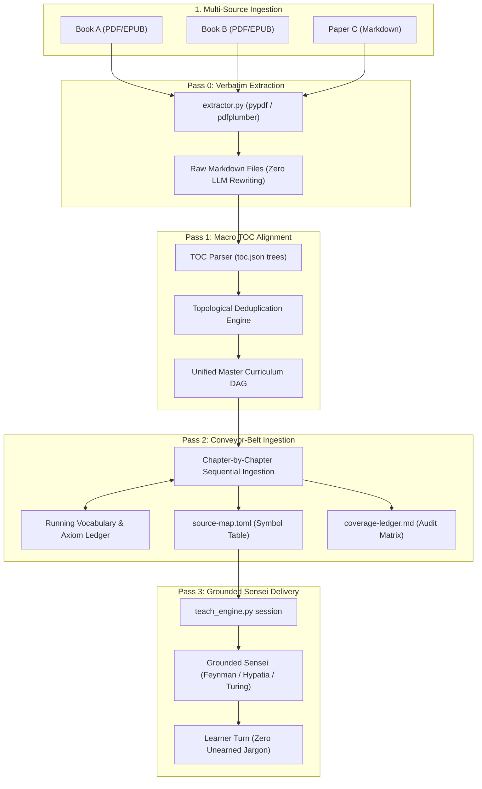
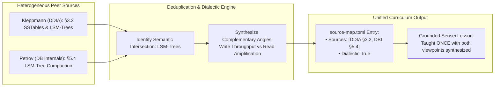
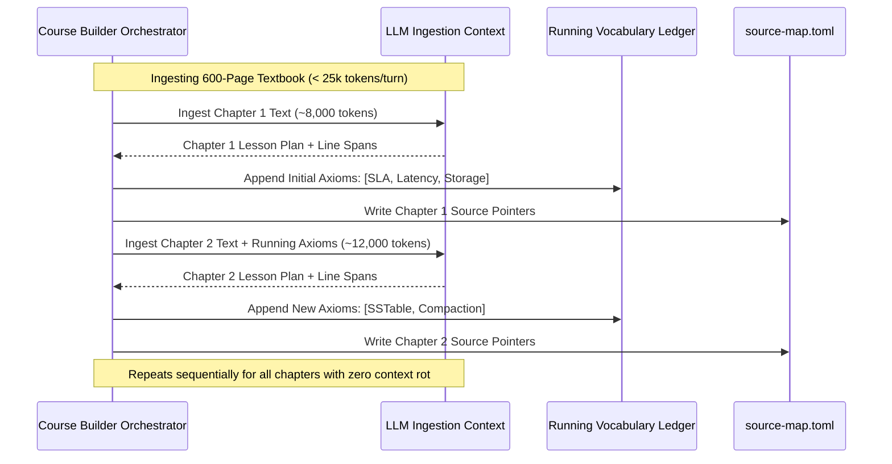

# Architecture Diagrams: Multi-Source Deterministic Compiler

> **Companion to**: `spec-multi-source-compiler.md`  
> **Rule**: Diagrams always land in a companion per BMad Spec Law Rule 2.

---

## 1. End-to-End Compiler Pipeline

---

## 2. Multi-Source Deduplication & Dialectic Synthesis

---

## 3. Conveyor-Belt Context Management (Preventing Context Rot)

