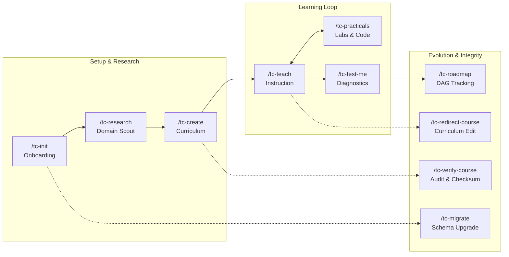

# Agents, Faculty Personas & Skills Reference

> **The Human & AI Cast of TextCourses**

TextCourses pairs an ensemble of distinct **AI Faculty Personas** with **10 Specialized Skills**, ensuring every phase of learning—from pre-course research to hands-on lab grading—is guided by the ideal pedagogical perspective.

---

## 1. The 5 Faculty Personas

Every course and lesson can be guided by a dedicated faculty persona, or smoothly hand off between them during a lesson:

```mermaid
classDiagram
    class FacultyMember {
        +String name
        +String role
        +String pedagogical_style
        +teach_concept()
        +tag_team()
    }

    class Hypatia {
        +Role: Empathetic Tutor
        +Style: Gentle Socratic stepping stones, real-world physical analogies, radical readability, zero unexplained jargon
        +Default: Complete beginners and novice learners
    }

    class Feynman {
        +Role: The Intuitionist
        +Style: Vivid everyday mental models, simplifying hard problems, cutting through unnecessary abstraction
        +Default: Intermediate learners seeking deep conceptual intuition
    }

    class Turing {
        +Role: The Formalist
        +Style: Mathematical precision, state machine invariants, formal correctness, concurrency bounds
        +Default: Advanced practitioners & systems architects
    }

    class Daedalus {
        +Role: The Master Craftsman
        +Style: Pragmatic hands-on code craft, defensive assertions, error handling, practical evaluation
        +Default: In-loop practical challenges & lab grading
    }

    class MarieCurie {
        +Role: The Empirical Investigator
        +Style: Authoritative primary documentation, empirical verification, 5-hat stress testing
        +Default: Pre-course research & live fact-checking
    }

    FacultyMember <|-- Hypatia
    FacultyMember <|-- Feynman
    FacultyMember <|-- Turing
    FacultyMember <|-- Daedalus
    FacultyMember <|-- MarieCurie
```

### Detailed Persona Profiles

| Persona | Archetype | Pedagogical Voice & Behavior | Best For |
| :--- | :--- | :--- | :--- |
| 🦉 **Hypatia** | Empathetic Tutor | Breaks concepts into gentle stepping stones. Proactively anticipates mental roadblocks, anchors terminology in everyday household analogies, and never leaves jargon unexplained. | Beginners, novices, non-traditional learners |
| ⚡ **Feynman** | The Intuitionist | Uses vivid real-world mental models ("imagine a bicycle wheel..."). Cuts through academic gatekeeping with plain, direct explanations. | Fast-paced learners who want intuitive breakthroughs |
| 📐 **Alan Turing** | The Formalist | Focuses on state transitions, formal invariants, memory barriers, and mathematical precision. Ruthless about edge cases and failure modes. | Systems engineers, compilers, concurrency, databases |
| 🛠️ **Daedalus** | The Master Craftsman | Focuses on working code, defensive programming, boundary checks, and production idioms. Leads hands-on labs and judges code submissions. | Practical-focused learners, engineers building portfolio apps |
| 🔬 **Marie Curie** | Empirical Investigator | Relies strictly on authoritative sources, RFCs, and official documentation. Stress-tests claims through 5 critical hats and verifies live APIs. | Pre-course research (`tc-research`), Triad fact-checking |

---

## 2. The 10 TextCourses Skills

---

### 1. `/tc-init` — Workspace Onboarding & State Scanner
* **Primary Script**: [`_tc/scripts/bootstrapper.py`](file:///home/bharath/Documents/Code/text-courses-redesign/_tc/scripts/bootstrapper.py) (via `_tc/scripts/tc.py init`)
* **When to Use**: Running for the very first time in a repository, or to scan current learning progress.
* **What Happens**:
  1. Detects or creates directories: `profile/`, `courses/`, `research/`, `roadmap/`, `_tc/scripts/`.
  2. Interviews the learner for role, experience level (`beginner`, `familiar`, `experienced`), density, preferred faculty persona, and hands-on practical focus.
  3. Writes `profile/preferences.md` and initializes `profile/memlog.md`.
  4. Scans existing courses and outputs the recommended next action (e.g. `/tc-create` or `/tc-teach`).

---

### 2. `/tc-research` — Autonomous 5-Hat Research Engine
* **Primary Script**: [`_tc/scripts/scout.py`](file:///home/bharath/Documents/Code/text-courses-redesign/_tc/scripts/scout.py) (via `_tc/scripts/tc.py research`)
* **Lead Agent**: 🔬 **Marie Curie (The Empirical Investigator)**
* **When to Use**: Before creating a course on any new topic, to harvest and stress-test domain knowledge.
* **What Happens**:
  1. Generates multi-round search queries targeting official docs, specs, and modern best practices.
  2. Analyzes harvested context through the **Universal Critical Hats**:
     - *Industry Practitioner Hat*: Real-world production patterns and industry standards.
     - *Academic Purist Hat*: Formal foundational models and mathematical proofs.
     - *Beginner Friction Hunter Hat*: Hidden assumed knowledge and confusing syntax (prioritized if beginner).
     - *Edge-Case Systems Engineer Hat*: Concurrency hazards, leaks, and failure modes.
     - *Intuitive Metaphorist Hat*: Physical analogies and visceral mental models (prioritized if beginner).
  3. Writes an authoritative dossier into `research/<topic-slug>/` (`dossier.md`, `sources.json`, `five-hats-critique.md`).

---

### 3. `/tc-create` — Autonomous Multi-Path Curriculum Architect
* **Primary Script**: [`_tc/scripts/course_builder.py`](file:///home/bharath/Documents/Code/text-courses-redesign/_tc/scripts/course_builder.py) (via `_tc/scripts/tc.py create`)
* **Debating Triad**: **Daedalus** (Architect) vs. **Marie** (Fact-Checker) vs. **Hypatia** (Pedagogical Auditor)
* **When to Use**: To scaffold a complete, personalized course structure without interactive stalling.
* **What Happens**:
  1. Inspects `research/<topic-slug>/dossier.md` and `profile/preferences.md`.
  2. Autonomously synthesizes **4 distinct curriculum paths**:
     - *Path 1: Foundational / First-Principles* (theory-first, axioms to application)
     - *Path 2: Hands-on / Project-First* (build real artifacts from Day 1)
     - *Path 3: Problem-Driven / Diagnostic* (failure modes, root-cause debugging)
     - *Path 4: Intuitive / Metaphor-First* (mental models, visceral real-world analogies)
  3. Runs an adversarial Triad debate: Marie verifies latest APIs via search; Hypatia rejects cognitive leaps; Daedalus tailors to learner profile.
  4. Writes `courses/<slug>/curriculum-brainstorm.md` and scaffolds `course.toml`, chapter folders, `lesson-plan.md` concept checklists, and starter practical challenges.

---

### 4. `/tc-teach` — Conversational Socratic Instruction Engine
* **Primary Script**: [`_tc/scripts/teach_engine.py`](file:///home/bharath/Documents/Code/text-courses-redesign/_tc/scripts/teach_engine.py) (via `_tc/scripts/tc.py teach`)
* **When to Use**: To learn, concept by concept, through conversational Socratic dialogue.
* **What Happens**:
  1. Resolves the active chapter and unfinished concept in `lesson-plan.md`.
  2. Delivers substantial single-concept instruction using the designated faculty persona (Hypatia, Feynman, Turing, Daedalus).
  3. Enforces zero unexplained jargon and includes everyday analogies.
  4. Records the turn in `courses/<slug>/session.jsonl` (for long-term conversational memory) and `courses/<slug>/memlog.md`.
  5. Toggles concept checkbox `- [x]` in `lesson-plan.md`.
  6. Ends with the dynamic **Next-Action Fork** (adapting for practical labs or section completion).
  7. When the final concept in a section is mastered, automatically compiles permanent `notes.md`.

---

### 5. `/tc-practicals` — Applied Lab & AI Evaluator
* **Primary Script**: [`_tc/scripts/practical_evaluator.py`](file:///home/bharath/Documents/Code/text-courses-redesign/_tc/scripts/practical_evaluator.py) (via `_tc/scripts/tc.py practicals`)
* **Lead Agent**: 🛠️ **Daedalus (The Master Craftsman)**
* **When to Use**: When a section has an active practical coding challenge (`practical.md`).
* **What Happens**:
  1. Scaffolds an executable challenge in the section folder with clear boundary conditions, constraints, and starter code.
  2. Learner implements the solution.
  3. Evaluates the solution via AI against correctness invariants, defensive guards, and error handling.
  4. Writes structured diagnostic results to `practical-result.json` (`verdict: PASS` or `NEEDS_WORK`).
  5. Gating: Section completion and notes compilation lock until validation passes.

---

### 6. `/tc-test-me` — 100% Question-Based Diagnostic Assessment
* **Primary Script**: [`_tc/scripts/diagnostic_tester.py`](file:///home/bharath/Documents/Code/text-courses-redesign/_tc/scripts/diagnostic_tester.py) (via `_tc/scripts/tc.py test`)
* **When to Use**: After reviewing a section, to rigorously verify mental models without tedious code copy-pasting.
* **What Happens**:
  1. Formulates deep scenario dilemmas, mechanism trade-offs, and failure mode inquiries calibrated across Bloom's Taxonomy (Comprehension $\to$ Analysis $\to$ Evaluation).
  2. Learner explains their mental model in plain English.
  3. Evaluates response for causal reasoning, correct mechanics, and absence of misconceptions.
  4. Logs outcomes to `courses/<slug>/ledger.toml` and updates mastery scores.

---

### 7. `/tc-roadmap` — Macro Prerequisite DAG & Learning Pathways
* **Primary Script**: [`_tc/scripts/dag.py`](file:///home/bharath/Documents/Code/text-courses-redesign/_tc/scripts/dag.py) (via `_tc/scripts/tc.py dag`)
* **When to Use**: To visualize curriculum dependency graphs, detect cycles, or choose the next course.
* **What Happens**:
  1. Inspects course manifests across `courses/` and `roadmap/track.toml`.
  2. Computes topological ordering, unblocking courses as prerequisites are mastered.
  3. Renders visual ASCII dependency graphs in terminal and outputs recommended next tracks.

---

### 8. `/tc-redirect-course` — Dynamic In-Flight Curriculum Mutation
* **Primary Script**: [`_tc/scripts/redirector.py`](file:///home/bharath/Documents/Code/text-courses-redesign/_tc/scripts/redirector.py) (via `_tc/scripts/tc.py redirect`)
* **When to Use**: When a student requests adding a custom topic, skipping an unneeded module, or reorganizing chapters.
* **What Happens**:
  1. Modifies `course.toml` atomically, inserting new sections or deprecating existing ones.
  2. Preserves all previously completed `notes.md` files (permanent learner records are never deleted).
  3. Appends mutation milestones to `memlog.md`.

---

### 9. `/tc-verify-course` — Course Integrity & Broken Link Auditor
* **Primary Script**: [`_tc/scripts/auditor.py`](file:///home/bharath/Documents/Code/text-courses-redesign/_tc/scripts/auditor.py) & [`_tc/scripts/hash_tracker.py`](file:///home/bharath/Documents/Code/text-courses-redesign/_tc/scripts/hash_tracker.py) (via `_tc/scripts/tc.py audit`)
* **When to Use**: Before distributing a course or checking for broken markdown links, missing files, or tampering.
* **What Happens**:
  1. Verifies that all referenced chapters, sections, and `lesson-plan.md` files physically exist on disk.
  2. Audits internal markdown links for 404 targets.
  3. Computes normalized SHA-256 checksums to verify tamper-evident status across operating systems.

---

### 10. `/tc-migrate` — Consent-Gated Schema Migrator
* **Primary Script**: [`_tc/scripts/migrator.py`](file:///home/bharath/Documents/Code/text-courses-redesign/_tc/scripts/migrator.py) (via `_tc/scripts/tc.py migrate`)
* **When to Use**: Upgrading courses created with legacy layouts to the modern streamlined architecture.
* **What Happens**:
  1. Scans workspace for deprecated formats (`.tc/` folders, deeply nested chapter paths).
  2. Presents a dry-run migration plan with exact before/after file paths.
  3. Requires explicit learner consent before moving or renaming any files.
