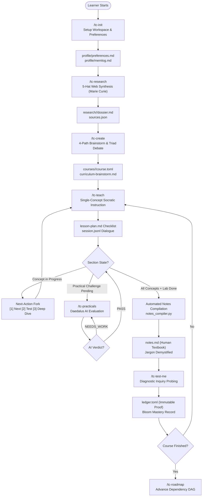

# TextCourses System Architecture

> **The Gold Standard for Sovereign, Local-First AI Apprenticeship**

TextCourses is an open-source, filesystem-native learning engine designed to replace passive video streaming and amnesic chat feeds with structured, interactive, single-concept AI apprenticeship.

---

## 1. Core Architectural Philosophy

```
  ┌────────────────────────────────────────────────────────┐
  │                 Human Learner (User)                   │
  └──────────────────────────┬─────────────────────────────┘
                             │ Conversational Interaction & Commands
                             ▼
  ┌────────────────────────────────────────────────────────┐
  │        Tier 1: AI Faculty & Specialized Skills         │
  │   Hypatia • Feynman • Turing • Daedalus • Marie Curie  │
  │  tc-init • tc-research • tc-create • tc-teach • ...    │
  └──────────────────────────┬─────────────────────────────┘
                             │ Deterministic Subprocess / CLI Invocations
                             ▼
  ┌────────────────────────────────────────────────────────┐
  │         Tier 2: Unified Runtime Engine (tc.py)         │
  │   scout • course_builder • teach_engine • practicals   │
  │   notes_compiler • diagnostic_tester • dag • memlog    │
  └──────────────────────────┬─────────────────────────────┘
                             │ Atomic Writes & Advisory File Locking
                             ▼
  ┌────────────────────────────────────────────────────────┐
  │        Tier 3: Sovereign Filesystem Substrate          │
  │     courses/ • research/ • profile/ • roadmap/ • _tc/  │
  └────────────────────────────────────────────────────────┘
```

1. **Sovereign & Local-First**: 100% of the learner's journey, progress, textbook notes, and code reside in their local filesystem or git repository. Zero cloud accounts, telemetry tracking, or proprietary database dependencies.
2. **Hybrid Deterministic Substrate**: State transitions, concept checkmarks, prerequisite DAG computation, code evaluation, and cryptographic integrity hashes are computed deterministically by standalone Python 3.11+ scripts via `uv run`. AI agents govern pedagogical explanation, Socratic dialog, and empathetic coaching.
3. **Dual-Register Knowledge Separation**:
   - **Human-First Notes** (`notes.md`): Formatted in clear, accessible plain English with everyday physical analogies, 3-bullet recaps, and zero unexplained jargon.
   - **AI-First Working Memory** (`memlog.md`, `session.jsonl`): Ultra-dense, token-minimal key-value telemetry ensuring zero chat amnesia without inflating LLM context budgets.
4. **Permanent, Immutable Knowledge (AD-7)**: Once a section is mastered, its compiled textbook `notes.md` file is permanently locked on disk. Learners can annotate or reference it forever without upstream documentation drift rewriting their history.

---

## 2. Directory Layout Architecture

The TextCourses workspace enforces a clean, human-navigable folder structure:

```
textcourses-workspace/
├── README.md                      # Learner quickstart & skill guide
├── WORKSPACE_GUIDE.md             # Visual filesystem layout & navigation guide
│
├── profile/                       # Sovereign learner profile & global memory
│   ├── preferences.md             # Learner role, experience level, teacher, practicals
│   └── memlog.md                  # Macro chronological milestone log across all courses
│
├── research/                      # Authoritative pre-course domain dossiers
│   └── <topic-slug>/              # Deep research compiled by Marie Curie (tc-research)
│       ├── dossier.md             # Comprehensive topic taxonomy, mechanics, pitfalls
│       ├── sources.json           # Scraped URLs, titles, timestamps, and citations
│       └── five-hats-critique.md  # 5-perspective dialectic review & gap analysis
│
├── courses/                       # Active and completed courses
│   └── <course-slug>/
│       ├── course.toml            # Course manifest (status, chapters, practical flags)
│       ├── curriculum-brainstorm.md # 4-path curriculum brainstorm & Triad consensus
│       ├── session.jsonl          # Turn-by-turn conversational Socratic dialogue history
│       ├── memlog.md              # Token-minimal pedagogical working memory
│       ├── ledger.toml            # Tamper-evident diagnostic assessment scores
│       │
│       ├── chapter-01/
│       │   ├── section-01/
│       │   │   ├── lesson-plan.md # Concept checklist (- [ ] / - [x])
│       │   │   ├── notes.md       # Human-first compiled textbook notes & analogies
│       │   │   ├── practical.md   # Hands-on coding challenge specifications
│       │   │   └── practical-result.json # AI validation verdict & rubric scores
│       │   └── section-02/
│       └── chapter-02/
│
├── roadmap/                       # Prerequisite dependency graphs
│   └── track.toml                 # Cross-course DAG and suggested learning paths
│
└── _tc/scripts/                   # Deterministic runtime engine (Single source of truth)
    ├── tc.py                      # Unified CLI dispatcher
    ├── scout.py                   # 5-hat research engine
    ├── course_builder.py          # Multi-path brainstorm & Triad consensus builder
    ├── teach_engine.py            # Conversational Socratic instruction engine
    ├── practical_evaluator.py     # Hands-on challenge evaluator
    ├── diagnostic_tester.py       # Bloom taxonomy inquiry generator & grader
    ├── notes_compiler.py          # Human-first textbook compiler & jargon auditor
    ├── dag.py                     # Prerequisite DAG validator & ASCII renderer
    ├── hash_tracker.py            # Cross-platform SHA-256 source integrity tracker
    └── auditor.py                 # Structural manifest and broken-link verifier
```

---

## 3. High-Level System Flowchart

The following diagram illustrates how the components and skills interconnect throughout a student's learning lifecycle:



---

## 4. Key Architectural Invariants

| Invariant | Implementation Mechanism | Purpose |
| :--- | :--- | :--- |
| **POSIX Atomic Writes** | Temp file write &rarr; `os.fsync` &rarr; `os.replace` | Guarantees that interrupted turns or system crashes never corrupt manifests, notes, or checklists. |
| **Stage Loading Budget (AD-5)** | Context filters restrict files loaded per skill turn to under 4,000 tokens | Eliminates context window bloat, reduces generation latency, and prevents out-of-order concept leakage. |
| **Question-Based Diagnostics (FR-13)** | Scenario dilemmas & hinge inquiries via `diagnostic_tester.py` | Eliminates tedious code-pasting into chat while rigorously verifying mental models. |
| **Permanent Notes Immutability (AD-7)** | `notes_compiler.py` refuses to overwrite without `--force` | Ensures student textbooks remain permanent personal artifacts. |
| **Cross-Platform Checksums (FR-41)** | CRLF to LF normalization and line-trailing whitespace stripping | Guarantees consistent SHA-256 hashes across Linux, macOS, and Windows checkouts. |
