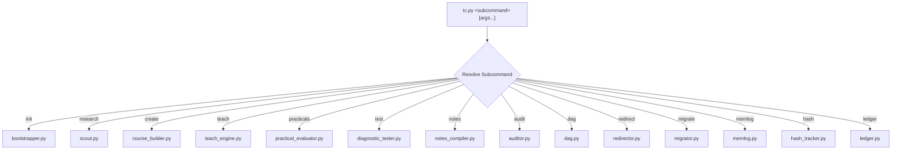

# Codebase Internals & Runtime Engine Reference

> **Deep Technical Guide for Core Developers & Contributors**

All core runtime logic in TextCourses is centralized under [`_tc/scripts/`](file:///home/bharath/Documents/Code/text-courses-redesign/_tc/scripts/). Every script is self-contained, adheres to the **PEP 723** script metadata specification, and can be executed either directly via `uv run _tc/scripts/<script>.py` or through the unified dispatcher `uv run _tc/scripts/tc.py <subcommand>`.

---

## 1. The Unified Runtime Dispatcher (`tc.py`)

[`_tc/scripts/tc.py`](file:///home/bharath/Documents/Code/text-courses-redesign/_tc/scripts/tc.py) is the canonical entry point for all engine subcommands:



### Module Mapping Table

| Subcommand | Underlying Script | Primary Responsibilities |
| :--- | :--- | :--- |
| `init` | `bootstrapper.py` | Workspace setup, directory verification, preference intake, and progress scanning |
| `research` | `scout.py` | Multi-round web search, 5-hat dialectic analysis, and dossier compilation |
| `create` | `course_builder.py` | 4-path curriculum brainstorming, Triad consensus debate, and course scaffolding |
| `teach` | `teach_engine.py` | Socratic turn delivery, `session.jsonl` logging, and adaptive Next-Action Fork |
| `practicals`| `practical_evaluator.py` | Lab scaffolding and AI code invariant evaluation |
| `test` | `diagnostic_tester.py` | Scenario inquiry formulation across Bloom taxonomy and grading |
| `notes` | `notes_compiler.py` | Human-first textbook compilation, jargon demystification, and readability audits |
| `audit` | `auditor.py` | Structural manifest checking, broken link detection, and verification reports |
| `dag` | `dag.py` | Prerequisite cycle detection, topological sorting, and ASCII tree rendering |
| `redirect` | `redirector.py` | Atomic section insertion, reordering, and module deprecation |
| `migrate` | `migrator.py` | Legacy format detection and consent-gated directory restructuring |
| `memlog` | `memlog.py` | Two-tier append-only micro-event logging |
| `hash` | `hash_tracker.py` | Normalized SHA-256 integrity checksums and drift detection |
| `ledger` | `ledger.py` | Assessment ledger atomic logging and misconception analysis |

---

## 2. In-Depth Script Breakdown

### A. `scout.py` (Research Engine)
- **Path**: `_tc/scripts/scout.py`
- **Core Functions**:
  - `scout_topic(topic, is_beginner=False)`: Orchestrates search query generation, web result synthesis, and dossier file writes.
  - `evaluate_with_five_hats(context, is_beginner=False)`: Applies critical lenses (Industry Practitioner, Academic Purist, Beginner Friction Hunter, Edge-Case Systems Engineer, Intuitive Metaphorist). Dynamically prioritizes beginner friction hunting and physical metaphors when `--beginner` is set.
- **Output Files**: `research/<slug>/dossier.md`, `sources.json`, `five-hats-critique.md`.

### B. `course_builder.py` (Curriculum Architect)
- **Path**: `_tc/scripts/course_builder.py`
- **Core Functions**:
  - `brainstorm_curriculum_paths(topic, dossier_text, preferences)`: Synthesizes the 4 distinct pedagogical paths (Foundational, Project, Diagnostic, Metaphor) and runs critical hat evaluations.
  - `conduct_triad_consensus(...)`: Simulates debate rounds between Daedalus, Marie, and Hypatia, outputting consensus rationale.
  - `scaffold_course_files(...)`: Atomically creates `courses/<slug>/course.toml`, `curriculum-brainstorm.md`, chapter folders, `lesson-plan.md` checklists, and starter practical files.

### C. `teach_engine.py` (Instruction & Socratic State)
- **Path**: `_tc/scripts/teach_engine.py`
- **Core Functions**:
  - `get_teaching_session(course_slug, ...)`: Resolves active chapter, loads current checklist concept, loads recent dialogue history from `session.jsonl`, and renders the context-adaptive Next-Action Fork.
  - `advance_lesson_concept(...)`: Toggles checklist item `- [x]`, appends to `memlog.md` and `session.jsonl`, and triggers automatic notes compilation when the section is complete and practicals have passed.
  - `render_fork(tag_team, practical_pending, section_completed)`: Dynamically generates the 4 fork options based on whether practical code submission or chapter advancement is active.
  - `append_session_event(...)` & `load_session_history(...)`: Manages persistent `session.jsonl` conversational memory.

### D. `practical_evaluator.py` (Applied Lab Evaluator)
- **Path**: `_tc/scripts/practical_evaluator.py`
- **Core Functions**:
  - `scaffold_lesson_practical(...)`: Generates `practical.md` in the section directory with boundary conditions, rules, and starter templates.
  - `evaluate_practical_submission(...)`: Evaluates submitted code for boundary handling, null safety, error handling, defensive guards, and code craft, writing `practical-result.json`.

### E. `notes_compiler.py` (Textbook Compiler & Jargon Auditor)
- **Path**: `_tc/scripts/notes_compiler.py`
- **Core Functions**:
  - `compile_notes(...)`: Compiles section notes into permanent, immutable `notes.md`.
  - `format_textbook_notes(...)`: Formats structured markdown with `## 3-Bullet Recap (In Plain English)`, `## Intuitive Mental Model & Analogy`, and `## Jargon Demystified & Everyday Analogies`.
  - `audit_jargon_and_readability(notes_text)`: Evaluates notes for plain English compliance, checks for visceral analogies, and flags ungrounded technical acronyms.

### F. `hash_tracker.py` (Cryptographic Integrity)
- **Path**: `_tc/scripts/hash_tracker.py`
- **Core Functions**:
  - `normalize_content_for_hashing(content)`: Harmonizes CRLF/CR to LF and strips line-trailing whitespace for text files, guaranteeing identical SHA-256 hashes across operating systems.
  - `compute_file_hash(filepath, normalize_text=True)`: Computes streaming 64KB digests for binary files, or normalized hashes for text assets.
  - `snapshot_directory(...)` & `diff_hashes(...)`: Recursively snapshots directory states and reports drift (added, modified, deleted).

---

## 3. Testing Architecture

TextCourses maintains a comprehensive, zero-mock regression test suite in [`tests/`](file:///home/bharath/Documents/Code/text-courses-redesign/tests/).

Run the full suite:
```bash
uv run pytest
```

### Test Suite Structure
- `test_tc_dispatcher.py`: Validates `tc.py` CLI dispatching, versioning, and JSON error reporting.
- `test_session_state.py`: Validates persistent Socratic dialogue logging to `session.jsonl`.
- `test_adaptive_fork.py`: Validates dynamic Next-Action Fork adaptation.
- `test_hash_normalization.py`: Validates cross-platform CRLF/whitespace hash normalization.
- `test_beginner_adaptation.py`: Validates end-to-end beginner calibration across research, builder, teaching, and testing.
- `test_curriculum_brainstorm.py`: Validates autonomous 4-path curriculum generation and Triad debate.
- `test_in_loop_practicals.py`: Validates hands-on lab scaffolding, AI evaluation, and completion gating.
- `test_jargon_guardrail.py`: Validates plain English readability and jargon demystification enforcement.
- `test_bootstrapper.py`, `test_course_builder.py`, `test_teach_engine.py`, `test_notes_compiler.py`, etc.
