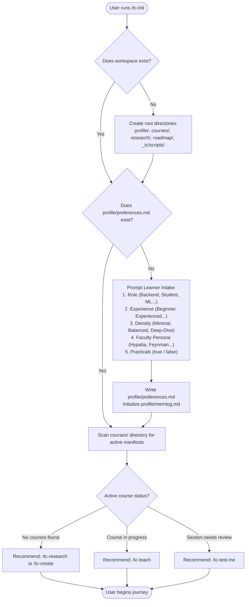
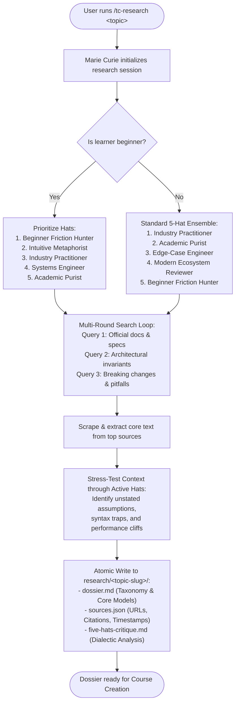
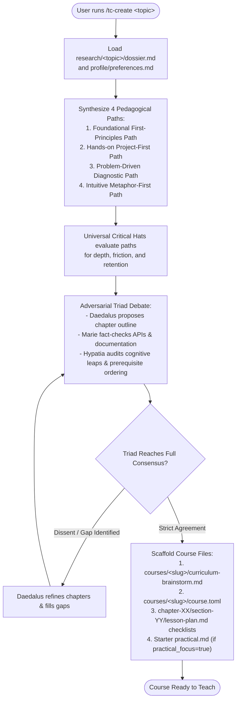
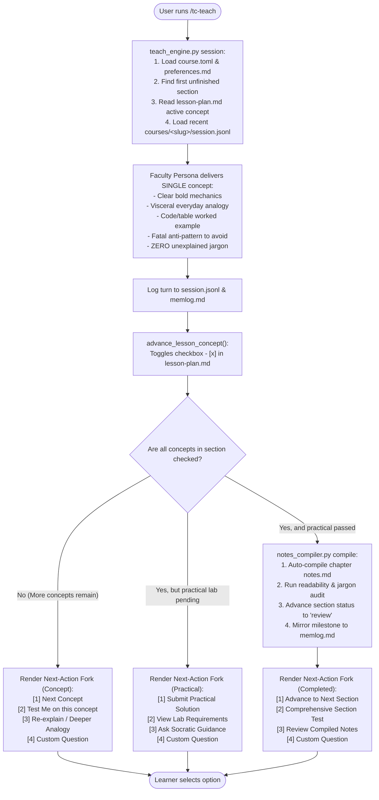
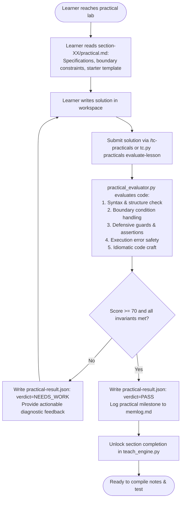
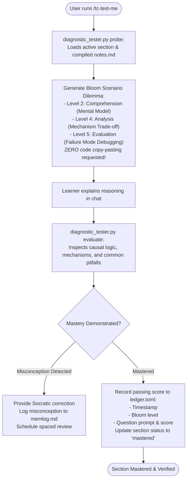

# Step-by-Step Execution Flows & Lifecycles

> **Complete Visual Flowcharts for Developers & Enthusiasts**

This document details every major workflow in TextCourses with exact decision trees, script invocations, file reads/writes, and state changes.

---

## Flow 1: Onboarding & Workspace Initialization (`/tc-init`)

### What Happens in Each Step:
1. **Directory Validation**: Runs `bootstrapper.py ensure --workspace .`. Checks if the directory structure exists; if missing, creates it safely without touching existing files.
2. **Preference Intake**: If `profile/preferences.md` is missing, prompts the user. If the user indicates `beginner`, sets `competency_level = "beginner"` and defaults the faculty persona to **Hypatia**.
3. **Progress Inspection**: Runs `bootstrapper.py status --json`, parsing all `courses/*/course.toml` manifests and checking which section is currently incomplete.
4. **Next Command Recommendation**: Deterministically outputs the single highest-priority next command.

---

## Flow 2: Autonomous 5-Hat Research (`/tc-research`)

### What Happens in Each Step:
1. **Hat Calibration**: `scout.py` checks `--beginner` flag or `profile/preferences.md`. If beginner, adjusts evaluation weights to hunt for cognitive traps and real-world analogies.
2. **Multi-Round Search**: Queries search engines for primary documentation, API changelogs, and common bugs.
3. **Tree-of-Thought Dialectic**: The 5 hats critique the extracted information. Gaps trigger secondary searches.
4. **Dossier Persistence**: Writes complete synthesized notes into `research/<topic-slug>/dossier.md` along with sources.

---

## Flow 3: Autonomous Course Creation (`/tc-create`)

### What Happens in Each Step:
1. **Autonomous Synthesis**: `course_builder.py` never stalls asking "how do you want this course created?". It immediately generates 4 distinct curriculum paths.
2. **Hat Stress-Testing**: Scores each path against learner profile preferences.
3. **Triad Deliberation**: Daedalus, Marie, and Hypatia argue until every section has valid prerequisites and empirical backing.
4. **Scaffolding**: Writes `curriculum-brainstorm.md` recording the debate, sets up `course.toml`, creates chapter directories, and writes `lesson-plan.md` checklists.

---

## Flow 4: Socratic Teaching & Adaptive Fork (`/tc-teach`)

### What Happens in Each Step:
1. **Session Recovery**: `teach_engine.py session` loads the course state and the last 5 turns from `session.jsonl`.
2. **Single-Concept Delivery**: Explains exactly one concept with zero jargon leakage.
3. **Atomic Checkmarking**: `lesson_tracker.py` flips `- [ ]` to `- [x]`.
4. **Adaptive Next-Action Fork**: If a practical lab is pending, option `[1]` transforms to submit practical code. If all concepts and labs are finished, `notes_compiler.py` compiles `notes.md` automatically and offers section advancement.

---

## Flow 5: In-Loop Practical Lab & AI Validation (`/tc-practicals`)

### What Happens in Each Step:
1. **Lab Scaffolding**: `practical_evaluator.py` creates `practical.md` with explicit functional requirements.
2. **AI Invariant Evaluation**: Checks student code against safety rules (boundary checks, null checks, error handling).
3. **Result Gating**: Writes `practical-result.json`. A `PASS` verdict is required before the section can lock as complete.

---

## Flow 6: Diagnostic Testing & Mastery Ledger (`/tc-test-me`)

### What Happens in Each Step:
1. **Question Formulation**: `diagnostic_tester.py` creates a scenario question targeting causal understanding.
2. **Evaluation**: Grades reasoning without requiring code pasting.
3. **Tamper-Evident Ledger**: Appends the test result to `courses/<slug>/ledger.toml` with advisory file locking.
