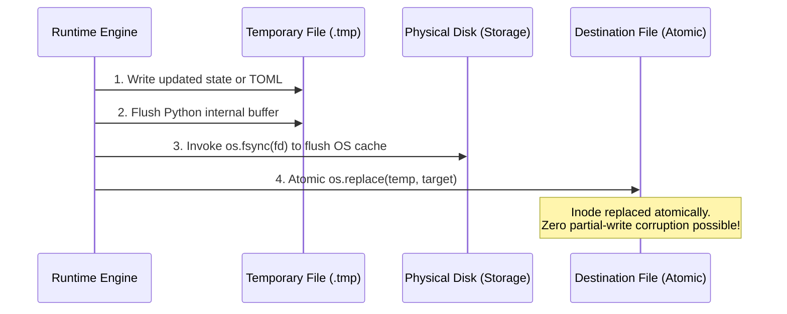

# Memory, Persistence & State Architecture

> **What Each File Remembers, When It Remembers It, and How It Persists**

One of TextCourses' greatest strengths is its completely transparent, filesystem-native state model. There are no hidden background databases or black-box state stores. Every piece of learning history is an open, inspectable file on disk.

---

## 1. Complete File Memory & Lifecycle Matrix

The table below outlines every stateful file in the TextCourses ecosystem, detailing **what it remembers**, **when it remembers it**, and **which scripts interact with it**:

| File Path | Format | What It Remembers | When It Is Written / Updated | Written By | Read By |
| :--- | :--- | :--- | :--- | :--- | :--- |
| `profile/preferences.md` | YAML / Markdown | Learner's role, competency level (`beginner`, `familiar`, `experienced`), density preference, faculty persona, and hands-on practical focus (`true`/`false`). | Written once during `/tc-init` onboarding; updated when learner changes settings. | `bootstrapper.py` | `scout.py`, `course_builder.py`, `teach_engine.py` |
| `profile/memlog.md` | Markdown List | Global chronological milestones across all courses (e.g. course enrollments, track completions, macro breakthroughs). | Appended whenever a course milestone or track level-up occurs. | `memlog.py`, `bootstrapper.py` | `/tc-init`, `/tc-roadmap` |
| `research/<slug>/dossier.md` | Markdown | Authoritative domain knowledge, architectural taxonomy, core mental models, code idioms, and verified failure modes. | Written upon completion of `/tc-research` autonomous research loop. | `scout.py` | `course_builder.py`, `skills/tc-create` |
| `research/<slug>/sources.json` | JSON | Exact provenance: scraped URLs, page titles, retrieval timestamps, and citation snippets. | Written during `/tc-research` web scraping and synthesis. | `scout.py` | `skills/tc-create`, verification audits |
| `research/<slug>/five-hats-critique.md` | Markdown | Deep dialectic evaluation from 5 critical hats (Practitioner, Purist, Friction Hunter, Systems Engineer, Metaphorist). | Written during `/tc-research` critical evaluation. | `scout.py` | `skills/tc-create` |
| `courses/<slug>/curriculum-brainstorm.md` | Markdown | The 4 synthesized curriculum paths (Foundational, Project, Diagnostic, Metaphor) and Triad consensus debate transcript. | Written during `/tc-create` before scaffolding course files. | `course_builder.py` | Learner, auditors, faculty personas |
| `courses/<slug>/course.toml` | TOML | Course metadata, overall status, competency level, practical focus, and chapter/section completion statuses. | Created during course creation; updated when section statuses transition (`not_started` $\to$ `in_progress` $\to$ `review` $\to$ `mastered`). | `course_builder.py`, `notes_compiler.py`, `redirector.py` | All runtime scripts & skills |
| `courses/<slug>/session.jsonl` | JSON Lines | **Turn-by-turn conversational Socratic history**: timestamps, section IDs, concept, teacher persona, student roadblocks, and dialogue summaries. | Appended on every concept advancement turn and interactive Socratic exchange in `/tc-teach`. | `teach_engine.py` | `teach_engine.py session` (loads trailing 5 turns) |
| `courses/<slug>/memlog.md` | Markdown List | **Token-minimal AI working memory**: dense micro-events (`- (concept by Hypatia) sec-01:mutex_basics:mastered`). | Appended atomically after every concept tick, student question, or section milestone. | `memlog.py`, `teach_engine.py` | `teach_engine.py`, `diagnostic_tester.py` |
| `courses/<slug>/ledger.toml` | TOML | **Tamper-evident assessment proof**: timestamped records of every diagnostic test, Bloom taxonomy level, and score. | Appended under advisory file lock (`fcntl.flock`) whenever a diagnostic test is graded. | `ledger.py`, `diagnostic_tester.py` | `bootstrapper.py`, `auditor.py` |
| `.../section-YY/lesson-plan.md` | Markdown Checklist | Granular concept stepping stones formatted as atomic checkboxes (`- [ ] Concept Name` $\to$ `- [x] Concept Name`). | Scaffolding creates unchecked items; `/tc-teach` flips checkmarks in real-time as concepts are mastered. | `course_builder.py`, `lesson_tracker.py` | `teach_engine.py`, `lesson_tracker.py` |
| `.../section-YY/notes.md` | Markdown | **Permanent Human-First Textbook**: 3-Bullet plain English recap, intuitive physical analogy, demystified jargon table, mechanics, and pitfalls. | Automatically compiled when the final concept and practical lab in a section are mastered. Permanent & immutable (never overwritten without `--force`). | `notes_compiler.py` | Human learner, review sessions |
| `.../section-YY/practical.md` | Markdown | Hands-on lab challenge specifications, boundary constraints, and starter code templates. | Scaffolding creates when `practical_focus = true`. | `practical_evaluator.py`, `course_builder.py` | Learner, Daedalus evaluator |
| `.../section-YY/practical-result.json` | JSON | AI evaluation results: verdict (`PASS` vs `NEEDS_WORK`), rubric score (0-100), and specific feedback points. | Written each time student submits lab code for evaluation. | `practical_evaluator.py` | `teach_engine.py` (gates section completion) |
| `roadmap/track.toml` | TOML | Multi-course prerequisite dependency graph (DAG) and track metadata. | Created during track scaffolding; updated when new courses are linked. | `dag.py`, `bootstrapper.py` | `dag.py`, `/tc-roadmap` |

---

## 2. Dual-Register Knowledge Separation

A critical innovation in TextCourses is the strict separation between what **humans read** and what **AI agents track**:

```
                              ┌───────────────────────────────────┐
                              │     Section Completed & Mastered  │
                              └─────────────────┬─────────────────┘
                                                │
                       ┌────────────────────────┴────────────────────────┐
                       ▼                                                 ▼
        ┌───────────────────────────────┐               ┌─────────────────────────────────┐
        │       Human-First Register    │               │        AI-First Register        │
        │       notes.md / textbook     │               │     memlog.md / session.jsonl   │
        ├───────────────────────────────┤               ├─────────────────────────────────┤
        │ • 3-Bullet Plain English Recap│               │ • Dense token-minimal notation  │
        │ • Physical Everyday Analogies │               │ • sec-01:event_loop:mastered    │
        │ • Zero Unexplained Jargon     │               │ • Timestamped Socratic dialogue │
        │ • Designed for Human Recall   │               │ • Sized for Minimal LLM Context │
        └───────────────────────────────┘               └─────────────────────────────────┘
```

### The Human-First Register (`notes.md`)
- **Tone**: Warm, accessible, rigorously structured, plain English.
- **Rule**: Never introduce a technical term without an intuitive everyday analogy or prior chapter grounding.
- **Auditing**: `notes_compiler.py audit-readability` programmatically scans for ungrounded acronyms and ensures the `## Jargon Demystified & Everyday Analogies` block is present.
- **Permanence**: Once written, it represents the learner's personal textbook. It is never overwritten by agent updates.

### The AI-First Register (`memlog.md` & `session.jsonl`)
- **Tone**: Ultra-compact, token-minimal telemetry.
- **Format**:
  ```markdown
  - (concept by Hypatia) sec-01:mutex_locking:mastered
  - (question by user) What prevents priority inversion?
  - (insight by user) Priority inheritance elevates blocking thread
  - (milestone) sec-01:status=review:notes_compiled
  ```
- **Context Budget**: When `/tc-teach` resumes, it only needs to load the trailing 15 lines of `memlog.md` and trailing 5 records of `session.jsonl`, maintaining flawless continuity within a tight ~500 token budget!

---

## 3. The Atomic State Mutation Pipeline

To guarantee zero file corruption even if a learner halts their terminal or loses power mid-turn:


